# 紙芝居DSL 4.0 台本作成ガイド

Copyright © 2026 Hiroya Kubo. この文書は[CC BY-SA 4.0](https://creativecommons.org/licenses/by-sa/4.0/)で提供します。

現在の公開App・Schema・サンプルの参照版は**4.0.0-rc.46**です。[対応Release](https://github.com/kubohiroya/turbowarp-kamishibai-app/releases/tag/v4.0.0-rc.46)と[npmの同一版](https://www.npmjs.com/package/@kubohiroya/turbowarp-kamishibai-app/v/4.0.0-rc.46)を使います。個別検証記録・図版の`4.0.0-rc.41`などは作成当時の版を示します。

対象: TurboWarpで台本ブロックを編集する作者、教材作成者、授業設計者\
扱う台本: `kamishibai [4.0] [ラベル]`からつながるブロック台本SB3\
確認日: 2026年10月21日

このガイドは、[台本DSL版の台本作成ガイド](../dsl-author-guides/dsl-4.0-author-guide.md)と同じ
場面・素材・命令を、台本ブロックの図版で説明します。最初に一作品を完成させる方は
[ブロック版「紙芝居を作る」](../tutorials/create-blocks.md)から始め、機能を増やすときに本書を参照してください。

## 公開サンプルをフォーム編集で開く

次のリンクから、公開済みのブロック台本SB3を日本語のExtension Data Editorへ直接読み込めます。

- [地震安全チュートリアルのブロック台本をフォーム編集で開く](https://kubohiroya.github.io/turbowarp-extension-data-editor/editor.html?lang=ja&project_url=https%3A%2F%2Fkubohiroya.github.io%2Fturbowarp-kamishibai-samples%2Fstories%2Ftutorial%2Ftutorial-blocks-4.0.sb3)
- [浦島太郎のブロック台本をフォーム編集で開く](https://kubohiroya.github.io/turbowarp-extension-data-editor/editor.html?lang=ja&project_url=https%3A%2F%2Fkubohiroya.github.io%2Fturbowarp-kamishibai-samples%2Fstories%2Furashima%2Furashima-blocks-4.0.sb3)

拡張の読み込み確認では、それぞれ「サンドボックスなしで実行する」を有効にして許可します。
ステージのコードにある専用定義ブロックの白い書類アイコンを押すと、JSONをフォームで編集できます。
編集後は、EditorのファイルメニューからSB3をコンピューターへ保存します。

## 利用する版と図版の読み方

公開プレリリース`4.0.0-rc.46`のCLIとStandard SB3を使います。正式版4.0.0は未公開です。
Node.js 24.0.0以上で公開CLIをexact installすれば、実命令ブロック、統一ハット、includeBlocks、
8種類の定義ブロックとフォーム編集が使えます。本体のcheckoutやCLIのビルドは不要です。
準備方法は[相互変換ガイド](../dsl-author-guides/dsl-4.0-block-script-conversion-guide.md)を参照してください。
rc.41は`ajv@8.20.0`を実行時依存に含むため、Ajvの追加導入は不要です。
旧rc.23・rc.25を固定して使い、`ajv/dist/2020.js`が見つからずCLIが起動しない場合は、
[rc.23・rc.25向けのAjv追加導入手順](../dsl-author-guides/dsl-4.0-block-script-conversion-guide.md#cli-ajv-workaround)を参照してください。

SVGのブロック図は実装のブロック名、入力値、接続を基に描いた説明図です。
PNGのフォーム画面はIssue #891対応の編集用拡張を実Editorで開いて撮影したものです。
オン／オフのPNGは、本体PR #909の表示改善を含むCLIで生成し、実Extension Data Editorで撮影しています。
補助ブロックは紫、命令ブロックは青緑で区別します。「この部分を使う」は専用のグレーです。
入力欄の文字は実際の英語表記を使います。
長い入力値は図の中だけで折り返しています。入力欄へは改行や省略を加えず、値全体を入力します。
狭い画面では図を左右にスクロールできます。図が複数に分かれている場合も、番号順に同じハットの下へ接続します。

台本のデータ・素材・実行の規則はDSL版と共通です。ランタイムとSchemaは同じ公開rc.46を使います。図版と旧版の説明は作成当時のものを保持します。音声の2命令はrc.39から利用できます。
portraitの`placement`、`offset`、`cornerRadius`も公開rc.41で使えます。

## チュートリアルと本書の使い分け

| 資料                       | 使うとき                 | 到達点                                             |
| -------------------------- | ------------------------ | -------------------------------------------------- |
| ブロック版「紙芝居を作る」 | 最初の作品を完成させる   | セリフを変え、検査して同じSB3で再生する            |
| 本書                       | 作品に機能を加える       | 素材、入力、分岐、見た目、命令を必要な範囲で調べる |
| Schemaリファレンス         | 入力欄へ入れる値を調べる | 項目の型、必須条件、制約を確認する                 |

本書を最初から最後まで通読する必要はありません。最小台本 → 素材・登場人物 → シーンと命令 →
保存・検査・ビルドの順に進め、カメラや複数台本は必要になったときに読みます。

## 台本ブロックの構造

台本の先頭は`kamishibai [4.0] [ラベル]`というハット型のブロックです。
版の入力は文字列`4.0`、ラベルの既定値は空文字です。版のために別の`story property`をつなぐ必要はありません。
ステージのラベル空欄のハットが主台本になります。同じStageに名前付きの台本を並べたり、
別のSpriteへ置いたりできます。ラベル空欄のハットは各Stage/Spriteに1個までです。
Stage上には名前が空のルートを1個だけ置きます。名前付きのハットはincludeBlocksから参照するモジュールで、1個だけでもルートにはなりません。
Sprite上の既存の空名宣言は従来のモジュール読取互換を保ち、ルートにはしません。

| ブロック             | 役割                                           | 主な入力                                         |
| -------------------- | ---------------------------------------------- | ------------------------------------------------ |
| `kamishibai`         | 台本の入口と版・識別名を宣言する               | `VERSION`は文字列`4.0`、`LABEL`は既定で空欄      |
| `includeBlocks`      | 同じSB3の別台本を物語開始時やCLIで合成する     | 参照先の`LABEL`                                  |
| 種類別の定義ブロック | 素材・登場人物・変数・台本全体の設定を登録する | 名前付き定義は`NAME`と`VALUE`、単一設定は`VALUE` |
| `scene`              | 一つのシーンを囲む                             | シーン名と`PROPERTIES`（シーン固有のJSON設定）   |
| 命令ブロック         | 背景変更、移動、セリフなどを指定する           | 素材名、秒数、対象アクターなど                   |
| `action options`     | 実命令一つへ追加属性を付ける                   | 安定ID、ブロックに入力欄がない引数など           |
| `custom action`      | 登録済みの独自命令を記述する                   | 対象、命令名、JSON引数、安定ID                   |

設定とシーンをハットの下へ接続し、命令を`scene`のC字の内側へ接続します。
ハットやシーンから切り離したブロックは台本に含まれません。宣言ハットと補助ブロックは
台本を記録するためのもので、ハット自体はイベントとして発火しません。緑の旗で起動するとランタイムが
空名ルートの台本を読み取り、タイトルを閉じるとその物語を開始します。編集後に物語を開始し直すと現在のブロックを読み直します。
再生後に編集した場合は、赤い停止ボタンで止め、フォームの値を保存してから緑の旗を押し、タイトルを閉じます。
rc.41では、前の再生でカメラ許可への応答を待っていても、古いカメラ開始処理が次の再起動を妨げません。
実行中の自動反映ではありません。不正な台本は診断を表示し、ファイル選択へ自動で切り替えません。

## 最小台本

次の図は、DSL版の最小台本と同じ内容です。`Beach`という背景、`Hero`スプライトと
`HeroIdle`というコスチュームを持つベースSB3を使います。名前が違う場合は設定と命令の参照を揃えます。

<figure class="block-script-diagram">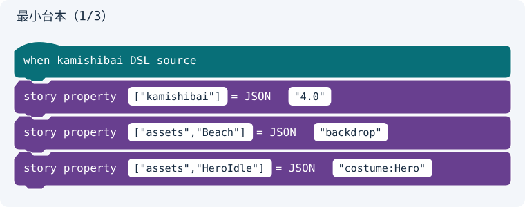</figure>

<figure class="block-script-diagram">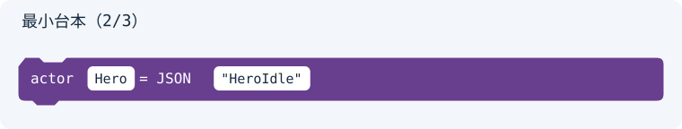</figure>

<figure class="block-script-diagram">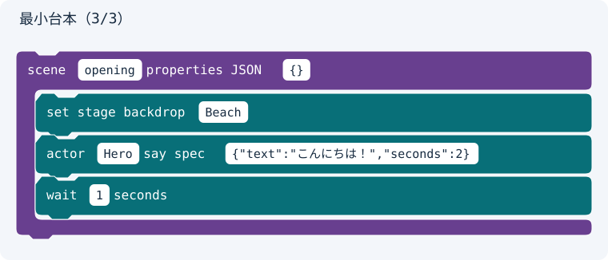</figure>

図の設定に加え、ハット直下に`control [production] = JSON [{"Space":"navigation.nextAction"}]`を1個つなぎます。
物語開始時に`production`を選ぶため、この名前の操作プロファイルが必要です。例ではSpaceを次の命令へ進む操作へ割り当てます。
空のキーマップはSchemaで受理しません。

上から、版の宣言、背景、衣装、登場人物を登録します。`opening`の内側では背景を変え、
`Hero`が2秒話し、1秒待ちます。最初につないだシーンから始まり、移動先を指定しなければ
次につないだシーンへ進みます。最後のシーンが終わると物語が終了します。

## ワークショップでポーズ数を選ぶ {#workshop-poses}

[私の浦島太郎の詳細ページ](https://kubohiroya.github.io/turbowarp-kamishibai-samples/stories/my-urashima/#block-workshop)の
「台本ブロックでワークショップを行う場合」から、2・3・4ポーズを選びます。
選んだ数のasset定義と`Princess.pose`の手順を設定したSB3が、日本語のExtension Data Editorで開きます。
台本の行頭の`#`を外して候補を選ぶ二つの操作は不要です。ポーズ列は2回繰り返します。

Princessスプライトの仮衣装`p1`、`p2`…を参加者のポーズ画像に置き換え、衣装名を保ちます。
モデルのラベルも`p1`、`p2`…にそろえ、asset定義`PoseModel2`の`source.url`を自分のモデルURLへ変更します。
`recognize actor`の書類アイコンで手順を編集し、保存後はSB3も保存します。
数を変える場合は、編集済みSB3を保存してから別のポーズ数を選びます。初期状態のブロック版も引き続き配布しています。
行頭の`#`を外す操作を体験する実習には、従来のYAML台本と作業用SB3を使用します。

## 種類別の定義ブロック

台本ハットの下へ、用途に合った定義ブロックを接続します。名前欄へYAMLの内部パスを入力する必要はありません。

| ブロック                          | NAME         | VALUEの例                                                 | YAMLの定義先             |
| --------------------------------- | ------------ | --------------------------------------------------------- | ------------------------ |
| `asset [NAME] = JSON [VALUE]`     | `HeroIdle`   | `"costume:Hero"`                                          | `assets[NAME]`           |
| `control [NAME] = JSON [VALUE]`   | `production` | `{"Space":"navigation.nextAction"}`                       | `controls.keymaps[NAME]` |
| `actor [NAME] = JSON [VALUE]`     | `Hero`       | `"HeroIdle"`                                              | `actors[NAME]`           |
| `textStyle [NAME] = JSON [VALUE]` | `title`      | `{"size":24,"color":"#ffffff"}`                           | `textStyles[NAME]`       |
| `variable [NAME] = JSON [VALUE]`  | `score`      | `0`、`false`、`"浦島"`                                    | `variables[NAME]`        |
| `cover = JSON [VALUE]`            | なし         | `{"backdrop":"Beach","bgm":"OpeningSound"}`               | `cover`                  |
| `loading = JSON [VALUE]`          | なし         | `{"backdrop":"Beach","costumes":["Loading1","Loading2"]}` | `loading`                |
| `recognition = JSON [VALUE]`      | なし         | `{"preview":{"mirroring":"mirrored"}}`                    | `recognition`            |

名前付きの5種類は1件につき1ブロックです。`control`の名前はキーマップ名で、値に`keymaps`を重ねません。
`actor`の値は初期コスチュームのアセットIDを表すJSON文字列です。オブジェクトにはしません。
`cover`、`loading`、`recognition`は名前欄のない設定で、台本ごとに各1個にまとめます。
複数の図の設定を組み合わせるときも、同じ単一設定のブロックを追加せず、既存の`VALUE`へ項目をまとめます。

## フォームでJSONを編集する

1. [編集ダイアログ付き日本語Editor](https://kubohiroya.github.io/turbowarp-extension-data-editor/editor.html?lang=ja)を開き、公開rc.46のCLIで生成した編集用SB3を読み込む
2. 編集用拡張をサンドボックスなしで読み込む
3. 配置した専用ブロックの左端にある白い書類のアイコンを押す。キーボードではアイコンへフォーカスしてEnterを押す
4. フォームの項目を編集し、「保存」を押す。「キャンセル」では入力欄へ反映しない
5. EditorのファイルメニューからSB3を保存し、同じ公開rc.46のCLIで書き戻し・検査する。file素材の更新がある場合はbundleを再ビルドする

名前付き定義の`NAME`はブロック上で編集し、フォームでは`VALUE`だけを編集します。
文字列はフォームの欄へそのまま入力し、JSON用の二重引用符は加えません。
`variable`は文字列・数値・真偽値を選びます。`asset`は素材の種類と入手元を選ぶと、必要な欄が表示されます。
`recognition`の任意設定は「設定しない」と「〜を設定」を切り替えます。

図は`Classroom`という素材に、作品フォルダー内の`classroom.svg`を指定する実フォームです。

<figure class="block-script-form">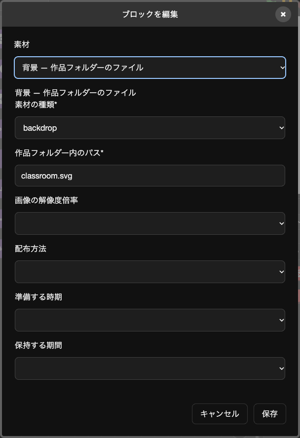</figure>

Schemaの型・必須項目・範囲などに違反すると保存できません。素材やアクターの参照先が存在するかなど、
台本全体の検査は保存したSB3の書き戻し・ビルド時にも行います。フォーム内の保存はSB3ファイル自体の保存とは別です。
変更なしで保存した場合は元のJSON文字列を保ち、変更は通常のUndo/Redoで戻せます。

GUIのフラグは既定OFFです。`blockEditorDialogs=1`をURLから外して再読込すると通常入力へ戻ります。
フォーム登録に対応しないEditorやサンドボックス内では、従来の文字列入力欄を使います。
古い編集用SB3の埋込拡張は自動更新されないため、専用ブロックがあるSB3も、フォーム対応版CLIで
YAMLへ書き戻してから再生成してください。

## 入力欄とJSONの規則

以後のJSON表記は、ブロックの文字列入力欄へ直接入力する場合の規則です。フォームでは引用符や括弧を手入力しません。

`asset`の`NAME`の例は`Beach`、その`VALUE`は`"backdrop"`です。
JSONは名前と値を括弧でまとめる記法です。文字列は二重引用符で囲みます。
通常の文字列入力欄（シーン名、アクター名など）にはJSON用の引用符を加えません。

| 入力             | 例                                    | 注意                                              |
| ---------------- | ------------------------------------- | ------------------------------------------------- |
| JSON文字列       | `"HeroIdle"`                          | `actor`の初期コスチュームなど。二重引用符を付ける |
| JSON数値・真偽値 | `1`、`true`、`false`                  | 引用符で囲まない                                  |
| JSONオブジェクト | `{"text":"こんにちは！","seconds":2}` | キーと文字列に二重引用符を使う                    |
| JSON配列         | `["Loading1","Loading2"]`             | `loading`の`costumes`などに使う                   |
| 省略可能な入力欄 | 空欄                                  | `moveTo`の任意easingなど。`0`とは違う             |

一つの命令は一つのブロックです。`SPEC`、`ROUTES`、`STEPS`などの値はJSON入力です。
rc.41で生成した編集用SB3では、`recognize actor [TARGET] pose steps [STEPS]`の`STEPS`を
白い書類アイコンからフォームで編集できます。「ポーズ認識の手順」の各行に、必須の`pose`と
任意の`skin`・`sound`を指定します。少なくとも1行が必要です。必須値がない場合は保存できません。
「キャンセル」は元の値を保ち、「保存」はブロックへ反映します。Editorの元に戻す・やり直すも使えます。
保存後はSB3もファイルへ保存してください。以前のSB3では、rc.46のCLIで編集用SB3を再生成すると利用できます。
すべての設定が専用の選択メニューになっているわけではありません。素材の`kind`や入力値の範囲は
[Schemaリファレンス](../dsl-author-guides/dsl-4.0-schema-reference.md)で調べます。
動的なScratchの変数や演算ブロックの評価は行いません。対応する静的な入力値を使用します。

## 旧story propertyと専用ブロックのない設定

`story property [PATH] = JSON [VALUE]`は旧形式の読取と、専用ブロックがない設定の保持に使います。
新しい編集用拡張のパレットでは非表示です。素材やアクターの新規登録には、上の専用ブロックを使います。
`branches`、`bubbleStyles`、`bubbleClosePolicies`、`presentation`、`audio`は引き続き生成済みの
`story property`を編集します。`PATH`は1〜2要素のJSON配列、`VALUE`はJSON値です。
名前付き項目がない明示的な空マッピングも、この形式で保持します。

旧`story property`を含む編集用SB3は、公開rc.46のCLIの`export-block-dsl`でYAMLへ戻し、
`author-block-dsl`で再生成すると専用ブロックへ移行できます。古いSB3に埋め込まれた編集用拡張は
パレットが自動更新されないため、CLIを更新するだけでは専用ブロックを追加できません。
旧ハットやYAML全文の文字列方式は読取対象外なので、元のYAMLから再生成します。

同じ名前の定義、`cover`などの単一設定の重複、旧`story property`と専用ブロックによる
同じ範囲への書込はエラーです。改名時には、命令などの参照先も作者が変更します。
元のYAMLと編集前SB3を保持してください。切り戻す場合は、専用ブロックの編集結果を対応CLIでYAMLへ
退避してから、変更前CLIでそのYAMLから再生成します。専用ブロックを含むSB3は旧CLIでの読取を保証しません。

## 名前の規則

アクター、スタイル、変数、分岐、安定IDは文字または`_`で始め、文字・数字・`_`・`-`を使います。
`1stActor`、`player score`、`main.hero`はこれらの識別子には使えません。
日本語はUnicode NFCで揃え、大文字と小文字を区別します。
素材IDとシーンIDは空でない文字列で、空白や記号も使えます。改名したときは参照する入力欄も直します。

## 素材と作業ファイルを用意する

ブロック台本SB3は編集と再生に使えます。file素材には、SB3内の対応するアセットバンドルが必要です。
最初にYAMLと素材を`build-dsl4`でbundle入りSB3へまとめ、そのSB3を`author-block-dsl --base`に渡します。
登場人物は、台本のアクターIDと同名のScratchスプライトを先にベースSB3へ用意します。
`actors`宣言やfile素材のビルドだけでScratchスプライトが自動生成されることはありません。
`author-block-dsl`だけでは外部素材の実体は新しく埋め込まれません。配布済みの素材入りブロック台本SB3ならそのまま編集できます。

セリフ・待機・シーン接続などの変更は、同じSB3で物語を開始し直して確認します。
file素材を追加したり、パス・内容を変更したりした場合だけ、編集後SB3から最新のYAMLを書き出してbundleを再ビルドします。
単一台本なら、元の作品フォルダーに別名のYAMLを出力し、編集後SB3を`--base`、そのYAMLを`--source`へ明示指定します。
`file`の基準位置と`--project-root`を揃え、更新前のSB3と元の素材も保持してください。
公開rc.46のCLIは、`--source`を省略してもSB3内の台本ブロックを自動選択しません。
元の`project.source.json`から編集前のYAMLを読み込むことがあるため、最新の書き戻し結果を指定します。

YAMLからの生成、ブロックからYAMLへの書き戻しは[相互変換ガイド](../dsl-author-guides/dsl-4.0-block-script-conversion-guide.md)を参照してください。

## 台本を複数に分ける（includeBlocks）

参照先のハットを`kamishibai [4.0] [共通シーン]`とし、主台本のハット直下へ
`includeBlocks [共通シーン]`を接続します。ラベルはSprite名とは独立した名前で、同じSB3全体から探します。

<figure class="block-script-diagram">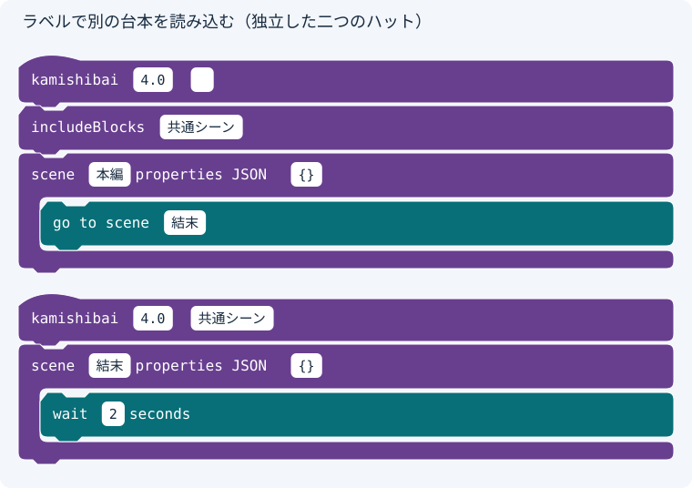</figure>

図の二つのハットは別々の台本です。`includeBlocks`はシーンの内側へ入れず、台本ハット直下の列へ置きます。
同じ列ではシーンの前後へ置けます。再生時の呼び出しではなく、物語開始時やCLIの処理時に台本を合成する参照です。
複数の参照は接続順に処理し、同名シーンなどの衝突はエラーにします。

空でないラベルはSB3全体で一意にし、大文字・小文字・空白を区別して完全一致させます。
日本語も使えます。ラベルを変更したら、参照元の`includeBlocks`も変更します。
存在しないラベル、空の参照、重複、自己参照・循環、変数や式による動的な入力はエラーです。

公開rc.41の`author-block-dsl`はinclude付きYAMLからこれらのブロックを生成できます。
編集後のSB3を`export-block-dsl`へ渡すと、主台本と参照先を分割したYAMLのZIPへ書き戻します。
ラベル順に`blocks-0001.k4.yml`などのファイル名を割り当て、主台本のincludeもその名前へ更新します。
参照先のブロックを編集した結果も対応するYAMLへ反映されます。参照されない台本がある場合はexportが失敗します。
生成・編集・保存・書き戻し・再生用ビルドのコマンドは
[相互変換ガイド](../dsl-author-guides/dsl-4.0-block-script-conversion-guide.md)を参照してください。

以後の表の`Actor.say`や`kind`などは、DSL版・Schemaと対応する項目名です。
実際のブロックの英語ラベルとJSON入力は図版に示します。専用の入力欄がない追加属性は
`action options`の`arguments`へ入れ、内側へ実命令を一つだけ接続します。実命令の入力値を重ねて上書きすることはできません。

## 素材（asset）を登録する

`assets`には、台本で使う背景、コスチューム、音、ポーズモデル、UI画像を、アセットIDという名前で登録します。
一つの素材について決めることは、次の二つです。二つは独立しており、組み合わせて使います。

| 決めること                   | 選択肢                                                    | 書き方                                               |
| ---------------------------- | --------------------------------------------------------- | ---------------------------------------------------- |
| どこからデータを持ってくるか | ①SB3内の素材、②作品フォルダーのファイル、③Web上のファイル | 短形式／`name`、`file`、`delivery: remote`＋`source` |
| いつ使える状態にするか       | 開始前（eager）、使うシーンの直前（lazy）                 | `loading: eager`／`loading: lazy`                    |

### 入手元を選ぶ

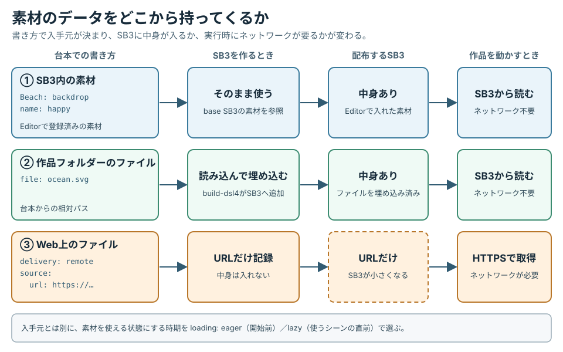

_図: 書き方によって、データの入手元と、配布するSB3へ中身が入るかが決まります。①と②はSB3だけで動き、③は実行時にネットワークから取得します。_

| 入手元                    | 書き方                                 | 配布するSB3            | 実行時のネットワーク | 向いている場面                                       |
| ------------------------- | -------------------------------------- | ---------------------- | -------------------- | ---------------------------------------------------- |
| ①SB3内の素材              | 短形式（`costume:Hero`等）または`name` | 中身が入っている       | 不要                 | TurboWarp Editorで描いた・取り込んだ素材を使う       |
| ②作品フォルダーのファイル | `file`                                 | 作成時に中身を埋め込む | 不要                 | 外部の画像・音声editorで作った素材を管理する（推奨） |
| ③Web上のファイル          | `delivery: remote`と`source.url`       | URLだけが入る          | 必要                 | 大きな素材でSB3を小さくしたい、公開済みモデルを使う  |

①は、TurboWarp Editorで作品へ登録済みの素材（base SB3内の素材）を名前で参照します。②は、
台本と同じ作品フォルダーにあるファイルを、`build-dsl4`がSB3へ埋め込みます。①と②は`delivery: embedded`
（既定値）であり、書く必要はありません。③だけは`delivery: remote`を明示します。

素材の種類（`kind`）によって、使用できる入手元が異なります。

| `kind`             | 用途                           | ①短形式 | ①`name` | ②`file`                   | ③remote                                 |
| ------------------ | ------------------------------ | ------- | ------- | ------------------------- | --------------------------------------- |
| `backdrop`         | ステージの背景                 | ○       | ○       | ○                         | ○                                       |
| `costume`          | アクターのコスチューム         | ○       | ○       | ○                         | ○                                       |
| `sound`            | 音                             | ○       | ○       | ○                         | ○                                       |
| `recognitionModel` | ポーズ認識・画像認識のモデル   | ×       | ×       | ○（モデルのディレクトリ） | ○（TurboWarp Teachable MachineのURL等） |
| `image`            | カメラプレビューの操作アイコン | ×       | ×       | ○                         | ○                                       |

一つのアセットでは、`name`、`file`、`source`のうち一つだけを指定します。`costume`では、どの入手元でも
`target`（アクターID）が必須です。

### 短形式

①SB3内の素材を、アセットIDと同じ名前で参照する場合に使用します。短形式は常に`eager`です。

<figure class="block-script-diagram">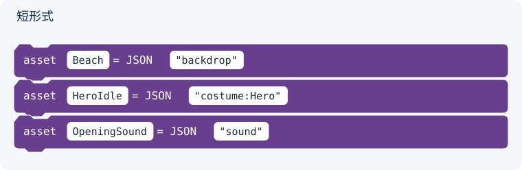</figure>

| 書式              | 意味                           |
| ----------------- | ------------------------------ |
| `backdrop`        | ステージの同名背景             |
| `costume:ActorID` | 指定アクターの同名コスチューム |
| `sound`           | ステージの同名音               |

### 名前付き形式

入手元を明示する場合や、`loading`等を指定する場合は名前付き形式を使います。次の例は、三つの入手元と
二つの準備時期を組み合わせています。

<figure class="block-script-diagram">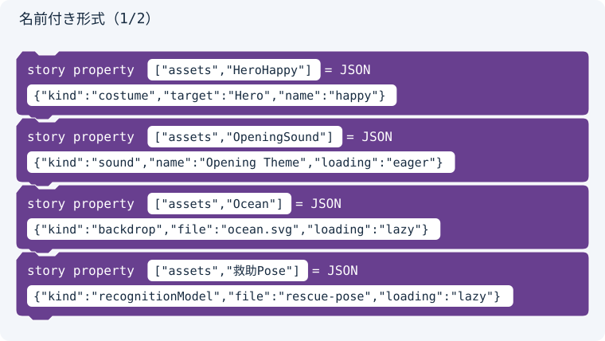</figure>

<figure class="block-script-diagram">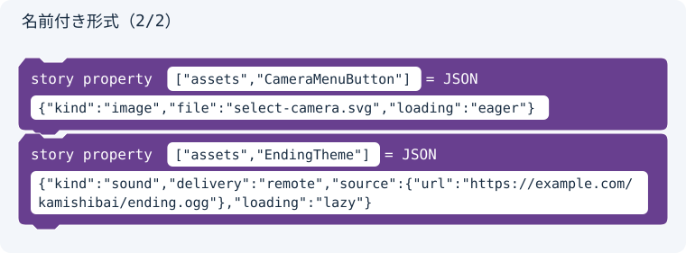</figure>

`image`はapp shellが表示するカメラプレビューの操作アイコン用であり、Scratch spriteやcostumeを追加する
機能ではありません。

bitmapのbackdropとcostumeは`bitmapResolution: 1`または`2`で論理解像度を指定できます。省略時は`1`です。
SVGなどのベクター素材には表示上の効果がないため、元素材の種類に合わせて使用してください。

#### `file`に書けるパス

`file`は宣言を書いたソースのディレクトリを基準に解決する、安全なPOSIX相対パスです。プロジェクトルート直下のentry
ソースではプロジェクトルート基準になります。

| 書き方                             | 可否 | 理由                                  |
| ---------------------------------- | ---- | ------------------------------------- |
| `ocean.svg`、`images/ocean.svg`    | ○    | 宣言したソースからの相対パス          |
| `/ocean.svg`                       | ×    | 絶対パス                              |
| `C:\ocean.svg`、`images\ocean.svg` | ×    | Windows絶対パスやバックスラッシュ     |
| `./ocean.svg`、`../ocean.svg`      | ×    | `.`または`..` segment                 |
| `https://example.com/ocean.svg`    | ×    | URI。Web上のファイルは③の書き方を使う |

ビルダーはfileのバイト列を成果物へ埋め込み、実行環境からのネットワーク取得を不要にします。
include文を使う場合は、正規化後のパスとsymlink実体の両方がプロジェクトルート内であることをバイト列の読込前に確認します。

#### Web上のファイル（remote）の内容を固定する

`source.url`にはHTTPS URLを指定します。検証情報を省略した場合は、取得した時点の内容を使います。公開先の
ファイルが差し替えられても同じ内容だけを使う場合は、`integrity`、`contentType`、`size`を三つとも指定します。
一部だけの指定はSchema errorです。

<figure class="block-script-diagram">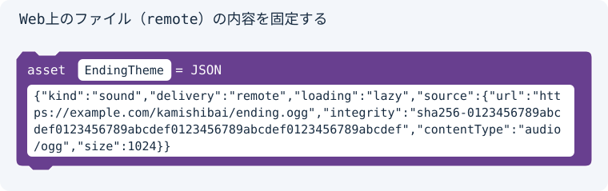</figure>

recognitionModelのURLは、検証情報を省略した場合は通常のTurboWarp Teachable Machineのディレクトリ、検証情報を指定した場合は
model archiveを指します。ネットワークなしで動かす必要がある作品では、remoteではなく②の`file`を指定し、
ビルダーでSB3へ埋め込みます。

### eagerとlazy

名前付きアセットには`loading: eager`または`loading: lazy`を指定できます。省略時と短形式は`eager`です。

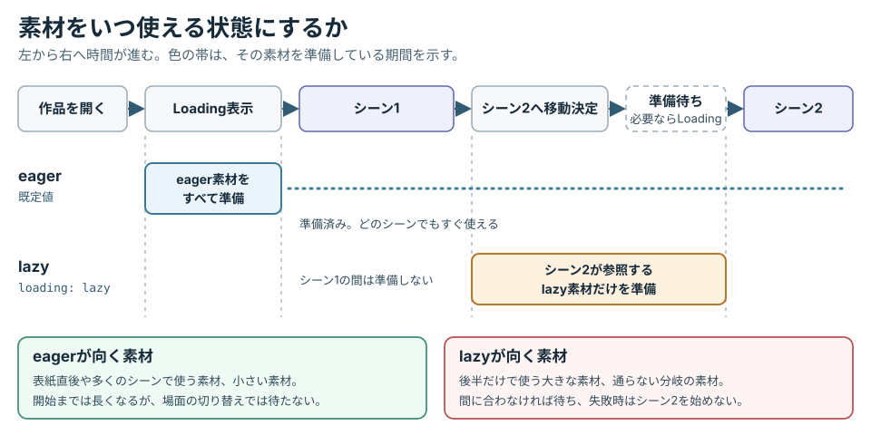

_図: eagerの素材は物語の開始前にまとめて準備します。lazyの素材は、そのシーンへ移動することが決まってから、
そのシーンが参照する分だけを準備します。_

|                    | `eager`（既定値）                        | `lazy`                                         |
| ------------------ | ---------------------------------------- | ---------------------------------------------- |
| 準備する時期       | 作品を開いた後、最初のシーンの前         | そのシーンへの移動が決まった後、シーン開始の前 |
| 開始までの待ち時間 | 長くなる                                 | 短くなる                                       |
| シーンの切り替え   | 待たない                                 | 準備が終わるまでLoading表示で待つことがある    |
| 準備に失敗した場合 | 物語を開始せず診断を表示                 | そのシーンのアクションを開始せず診断を表示     |
| 向いている素材     | 最初から使う素材、多くのシーンで使う素材 | 後半や一部の分岐だけで使う大きな素材           |

入手元と準備時期を組み合わせると、次のように動きます。

| 入手元                    | `eager`                                             | `lazy`                                                        |
| ------------------------- | --------------------------------------------------- | ------------------------------------------------------------- |
| ①SB3内の素材              | SB3内のデータを開始前に使える状態にする             | SB3内のデータを、使うシーンの直前に使える状態にする           |
| ②作品フォルダーのファイル | 埋め込んだデータを開始前に使える状態にする          | 埋め込んだデータを、使うシーンの直前に使える状態にする        |
| ③Web上のファイル          | 開始前にURLから取得する。オフラインでは開始できない | 使うシーンの直前にURLから取得する。取得するまで待つことがある |

①と②では、`lazy`でもデータ自体は配布するSB3に入っています。`lazy`で変わるのは、使える状態にする処理
（展開や登録）の時期だけで、SB3の大きさは変わりません。SB3を小さくしたい場合は③を使います。

カメラプレビューの操作から参照する`image`はプレビュー開始時に必要なため、`loading: eager`だけを使用します。
`lazy`のcontrol画像参照は意味検証でエラーになります。

### 選び方の目安

| したいこと                                          | 書き方                                                     |
| --------------------------------------------------- | ---------------------------------------------------------- |
| TurboWarp Editorで描いたコスチュームをそのまま使う  | 短形式`costume:Hero`、実名が違えば`name`                   |
| 外部editorで作った画像・音声をフォルダーで管理する  | `file`（必要に応じて`loading: lazy`）                      |
| ネットワークのない教室でも確実に動かす              | ①または②。③のremoteは使わない                              |
| 物語の開始を早くしたい                              | 後半だけで使う素材を`loading: lazy`にする                  |
| SB3のファイルサイズを小さくしたい                   | 大きな素材を③`delivery: remote`にする                      |
| 公開済みのTurboWarp Teachable Machineのモデルを使う | `kind: recognitionModel`、`delivery: remote`、`source.url` |

## 登場人物（Actor）を登録する

`actor [NAME] = JSON [VALUE]`で、アクターIDと初期コスチュームを対応付けます。
例は`NAME`が`Hero`、`VALUE`が`"HeroIdle"`です。文字列入力欄では二重引用符も入力します。
フォームでは、図のように`HeroIdle`だけを入力します。

<figure class="block-script-form">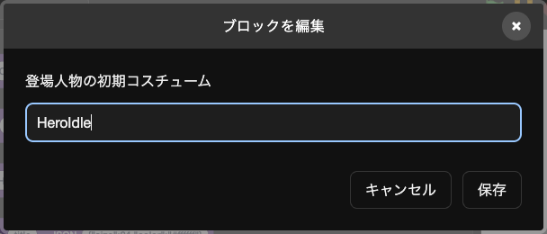</figure>

<figure class="block-script-diagram">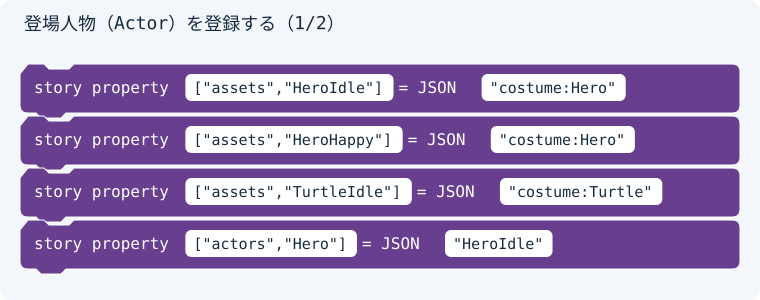</figure>

<figure class="block-script-diagram">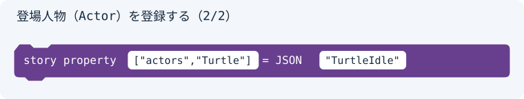</figure>

初期コスチュームは`costume`アセットであり、その`target`がアクターIDと一致している必要があります。
アクションでは`Hero.show`、`Turtle.say`のように、アクターIDと命令を`.`でつなぎます。

## 表紙、読み込み表示、ポーズ認識、カメラ映像を設定する

ここまでで素材と登場人物がそろいました。次は、物語が始まる前と、物語の外側に出る画面の設定です。いずれもトップレベルのキーとして一度だけ書き、シーンごとに書き分けるものではありません。

### 表紙

<figure class="block-script-diagram">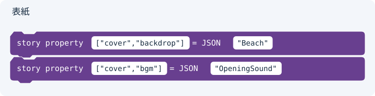</figure>

<figure class="block-script-form">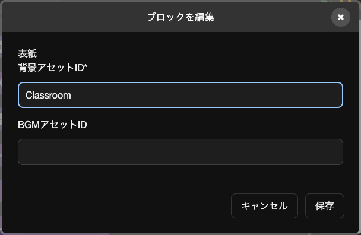</figure>

`backdrop`は必須で、背景アセットを指定します。`bgm`は任意で、音アセットを指定します。

### 読み込み中の表示

<figure class="block-script-diagram">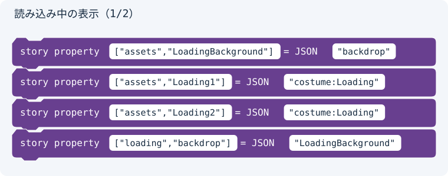</figure>

<figure class="block-script-diagram">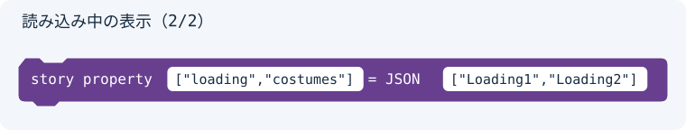</figure>

<figure class="block-script-form">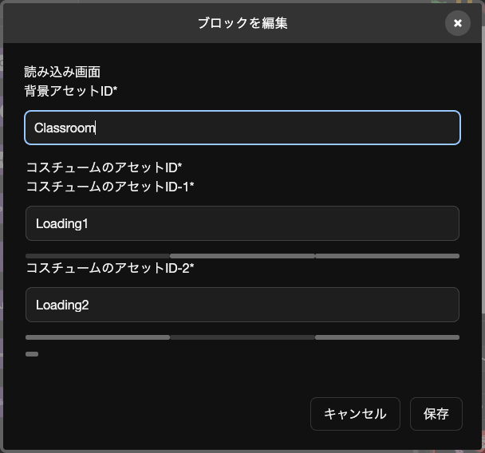</figure>

`loading`を記述する場合は、背景と一つ以上のコスチュームが必要です。`costumes`は同じ意味の値の集合なので
JSON配列で指定します。

### 認識音

ポーズ認識と画像認識の設定は、トップレベルの`recognition`へまとめて書きます。

<figure class="block-script-diagram">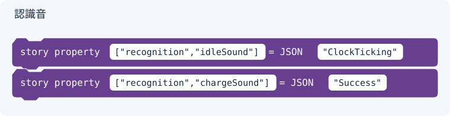</figure>

<figure class="block-script-form">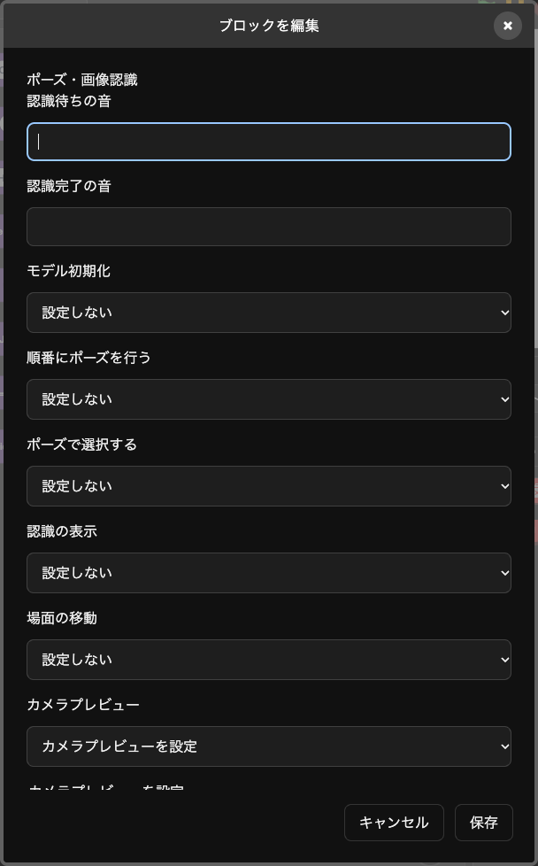</figure>

`idleSound`と`chargeSound`はそれぞれ任意です。両方を省略した無音、片方だけ、両方を指定した設定を
受理します。指定する場合、参照先は音アセットでなければなりません。音を省略してもsequence、selection、
feedback、navigation、プレビューは独立して設定できます。

### Poseモデルの初期化方法

sceneをskipしたり遷移先を変更したりする作品では、不要になったモデル初期化をcancelして、直近で必要な
モデルだけを準備できます。

<figure class="block-script-diagram">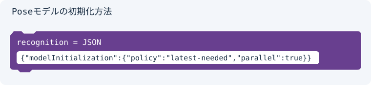</figure>

`policy: latest-needed`は重い初期化を実行中1件、最新待機1件までに制限します。Aの初期化中にB、Cの順で
要求が変わった場合、Bを開始せず、Aを安全境界でcancelしてCだけを開始します。poseを使わないsceneへ
skipした場合は待機要求を破棄し、新しいモデル初期化を開始しません。

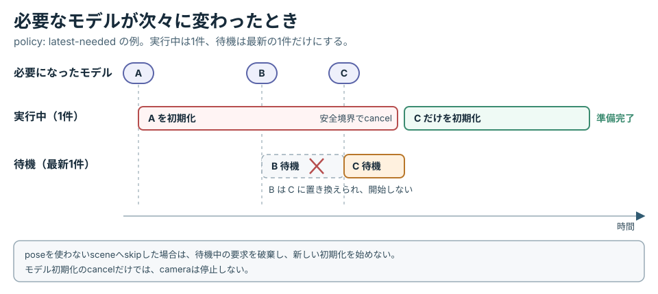

_図: `latest-needed`では、途中で不要になったモデルの初期化を続けず、最後に必要になったモデルだけを準備します。_

`parallel: true`では、cameraの起動とモデル準備、モデル記述子の復号・SHA検証とclassifier loadなど、
依存関係のない処理を重ねます。最初の認識だけがcameraと登録済みモデルの両方を待ちます。モデル初期化の
cancelだけでcameraは停止しません。

省略時は`policy: legacy`、`parallel: false`です。これは従来動作へ設定だけで戻せる安全な既定値です。

| 設定                        | 動作                                                             | 向いている作品                                   |
| --------------------------- | ---------------------------------------------------------------- | ------------------------------------------------ |
| `policy: legacy`（既定値）  | 従来どおりの初期化                                               | sceneを順番どおりに進める作品                    |
| `policy: latest-needed`     | 実行中1件、最新待機1件まで。不要になった初期化をcancelする       | sceneのskipや分岐で遷移先が変わる作品            |
| `parallel: false`（既定値） | 依存関係のない処理を重ねない                                     | 動作を従来と揃えたい作品                         |
| `parallel: true`            | cameraの起動とモデル準備などを重ねる。最初の認識だけが両方を待つ | ポーズ認識が始まるまでの待ち時間を短くしたい作品 |

`latest-needed`の実行にはTurboWarp Teachable Machine 1.10.0以降が必要です。公開プレリリース4.0.0-rc.41はTurboWarp Teachable Machine 3.5.1をexact pinします。

### カメラ映像の表示と操作

story全体の左右反転既定と、必要な操作UIを`recognition.preview`へ記述します。

<figure class="block-script-diagram">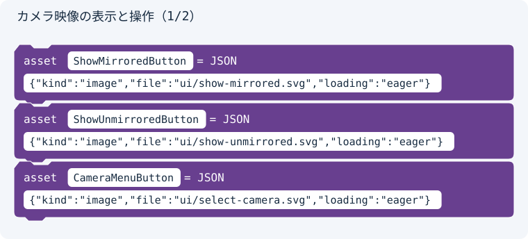</figure>

<figure class="block-script-diagram">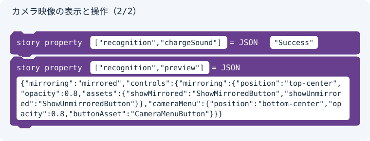</figure>

<figure class="block-script-form">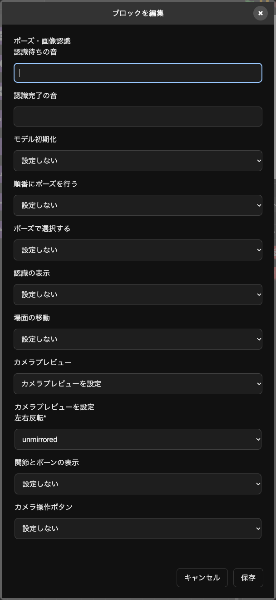</figure>

`mirroring`は`mirrored`または`unmirrored`で、省略時は従来表示と同じ`mirrored`です。これはpreview
canvasの見た目だけを変更し、認識へ渡すframe、pose confidence、sequence／selection判定を変更しません。

カメラ映像まわりの設定が何に影響するかは、次のとおりです。

| 設定                                    | カメラプレビューの表示               | 認識へ渡す映像                 | confidence・ポーズ判定 |
| --------------------------------------- | ------------------------------------ | ------------------------------ | ---------------------- |
| `preview.mirroring`                     | story全体の左右反転を変える          | 変えない                       | 変えない               |
| sceneの`posePreview.mirroring`          | そのsceneだけ左右反転を変える        | 変えない                       | 変えない               |
| `preview.controls.mirroring`            | 左右反転を切り替えるbuttonを表示する | 変えない                       | 変えない               |
| `preview.controls.cameraMenu`           | camera選択menuを表示する             | 選んだcameraの映像に切り替わる | 変えない               |
| `preview.overlay`（関節・ボーンの表示） | 関節とボーンを重ねて描く             | 変えない                       | 変えない               |

`controls`には左右反転buttonとcamera選択menuの一方または両方を記述します。配置は
`top-center`、`bottom-center`、`left-center`、`right-center`と四隅の8 anchor、`opacity`は0〜1です。
同じanchorでは左右反転button、camera menuの順に並びます。controlを省略した場合はUIを生成せず、
暗黙の標準iconも補いません。buttonには台本画像とは別にlocale対応の名前、focus表示、keyboard操作を
app shellが提供します。

camera menuは開くたびに利用可能な入力を列挙します。`default`、`front`、`back`と検出済みcameraを
選べますが、端末固有の物理device IDは台本、StoryDocument、`variables`へ保存しません。opaqueなIDと
UIの選択状態はapp shellがsession内だけで保持し、camera切替失敗時は以前のcameraと表示へ戻します。
起動時固定・既定OFFの`dsl4CameraPreviewControls`がOFFならcontrol画像、DOM、listener、上流camera APIへ
接続しません。

#### ポーズの関節とボーンを重ねる

認識中の17関節と12本の標準ボーンをカメラプレビューへ重ねる場合は、
`recognition.preview.overlay`を記述します。

<figure class="block-script-diagram">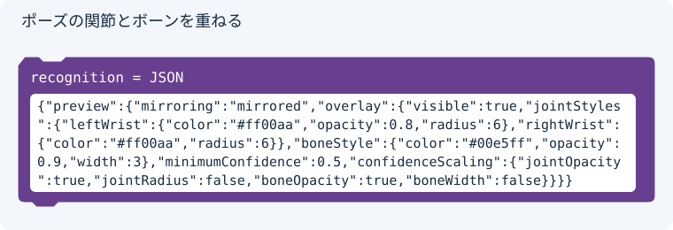</figure>

`jointStyles`では次の17個のPoseNet関節名をkeyにし、円の`color`、`opacity`、`radius`から必要な値だけを
上書きします。

`nose`、`leftEye`、`rightEye`、`leftEar`、`rightEar`、`leftShoulder`、`rightShoulder`、
`leftElbow`、`rightElbow`、`leftWrist`、`rightWrist`、`leftHip`、`rightHip`、`leftKnee`、
`rightKnee`、`leftAnkle`、`rightAnkle`

関節の既定値は`color: '#00e5ff'`、`opacity: 1`、`radius: 4`です。`boneStyle`は12本で共通し、
既定値は`color: '#00e5ff'`、`opacity: 0.9`、`width: 3`です。opacityは0〜1、radiusとwidthは
0以上の有限値にします。空白だけのcolorは使用できません。

`minimumConfidence`は0〜1で、省略時は`0.5`です。関節は自身のconfidenceがこの値未満なら隠れ、
ボーンは両端のどちらか一方でも未満なら隠れます。`confidenceScaling`の四項目は省略時にすべて`false`です。
`true`にした関節のopacity／radiusはその関節のconfidenceを、ボーンのopacity／widthは両端のうち低い
confidenceを倍率として、0から設定値まで変化します。この表示設定は認識入力や判定値を変更しません。

`overlay`を書いた場合の`visible`は省略時に`true`です。一方、`overlay`自体を省略した既存のDSL 4.0台本は
従来互換で非表示になります。overlayだけを隠しても認識は継続します。カメラプレビューを隠すとoverlayも隠れ、
認識停止では描画が消え、camera停止ではSVG要素も破棄されます。表示はpreviewの配置と左右反転に追従します。

| 状態・操作                          | overlayの表示                                |
| ----------------------------------- | -------------------------------------------- |
| `overlay`を省略                     | 表示しない（従来互換）                       |
| `overlay`を書き、`visible`を省略    | 表示する                                     |
| `visible: false`                    | 隠す。認識は続く                             |
| カメラプレビューを隠す              | プレビューと一緒に隠れる                     |
| 認識を停止する                      | 描画が消える                                 |
| cameraを停止する                    | 描画用のSVG要素も破棄する                    |
| confidenceが`minimumConfidence`未満 | その関節、または片端がその関節のボーンを隠す |

実行にはTurboWarp Teachable Machine 1.12.0以降が必要です。DSL runtimeは同版のcomposition APIだけを呼び、独自の描画実装を
持ちません。専用機能フラグはなく、すべてのruntime profileで同じように利用できます。問題時は
`overlay`設定を台本から削除すると、既存台本と同じ非表示へ戻せます。

## SVG Textを設定する

DSL 4.0の標準テキスト表現はSVG Textです。最初に`textStyles`で名前付きスタイルを定義します。

<figure class="block-script-diagram">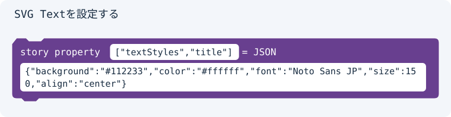</figure>

<figure class="block-script-form">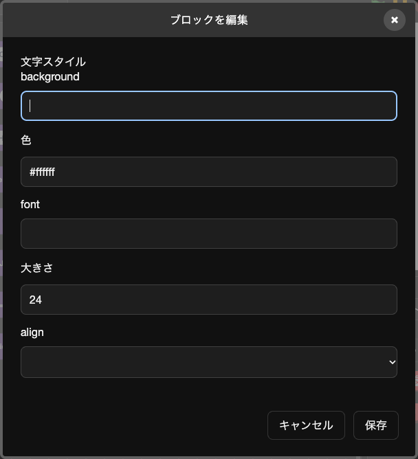</figure>

| 項目         | 値                        |
| ------------ | ------------------------- |
| `background` | 背景色を表す文字列        |
| `color`      | 文字色を表す文字列        |
| `font`       | 空でないフォント名        |
| `size`       | 0より大きい数値           |
| `align`      | `left`、`center`、`right` |

アクター自身へテキストを表示するときは`setText`を使います。

<figure class="block-script-diagram">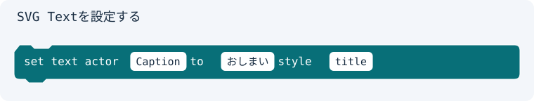</figure>

行形式のText Asset commandは4.0 core schemaにありません。`textStyles`と`Actor.setText`を使用してください。

## セリフの見た目（bubble style）を設定する

`Actor.say`と`Actor.think`で同じ吹き出し表現を再利用するときは、トップレベルの`bubbleStyles`へ
名前付きの部分styleを定義します。style名には内部の空白や日本語も使用できます。

<figure class="block-script-diagram">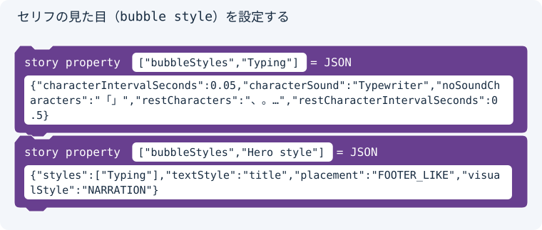</figure>

style定義の`styles`配列で既存styleを記載順に合成し、その定義自身の値で上書きできます。循環参照、
未定義style、同じstyleの重複指定はエラーです。各styleは部分設定にでき、文字送りの相互依存は合成後の
effective styleに対して検査します。

`characterIntervalSeconds`はUnicode grapheme cluster一つを表示してから次を表示するまでの秒数です。
`characterSound`は各文字のsound、`noSoundCharacters`は文字音を鳴らさない文字、`restCharacters`は
表示後の間隔を`restCharacterIntervalSeconds`へ置き換える文字です。

`textStyle`、`placement`、`visualStyle`、`portrait`、`continueIndicator`で吹き出しを構成できます。
さらに`reveal`、`audio`、`showAnimation`、`hideAnimation`、`visibleAnimations`で段階表示、音、animationを
指定できます。各fieldの列挙値と必須条件はSchemaリファレンスの「吹き出しstyle」を参照してください。

### 吹き出しの形と配置の見本

次の図は、吹き出しを描画するTurboWarp Bubbleの説明書から引用したものです。`bubbleStyles`に書く値と、
実際の見た目の対応を確認できます。

`visualStyle`には次の10種類を指定できます。

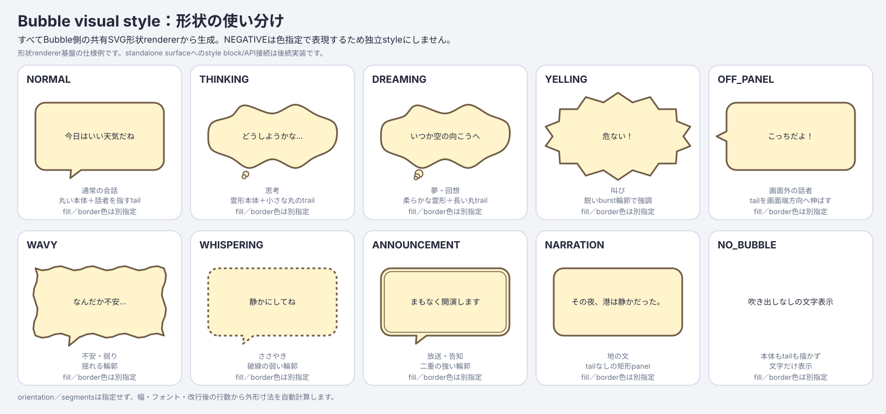

_図: `NORMAL`、`THINKING`、`DREAMING`、`YELLING`、`OFF_PANEL`、`WAVY`、`WHISPERING`、`ANNOUNCEMENT`、
`NARRATION`、`NO_BUBBLE`の形。`NO_BUBBLE`は本体を描かず、文字や表情だけを表示します。_

`placement`には、アクターを基準にした16方向（`up-right`等）または0〜360度と、背景を基準にした
`HEADER_LIKE`、`CENTER`、`FOOTER_LIKE`を指定できます。

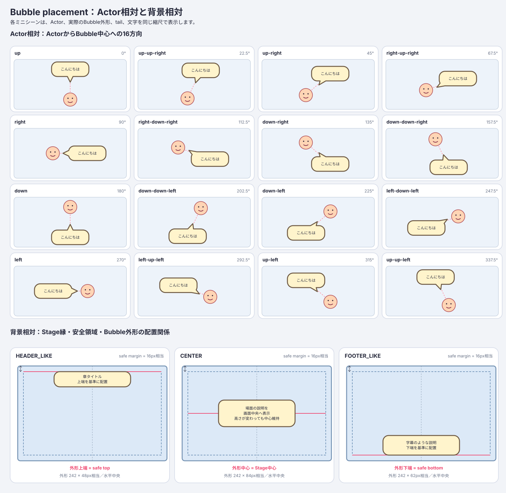

_図: アクター相対の配置ではしっぽがアクターを向き、背景相対の配置ではしっぽを付けず、アクターの位置に
関係なく画面の上部、中央、下部へ置きます。_

アクター相対の配置では、`distance`、`tailLength`、`offset`で吹き出しとアクターの距離を調整できます。
背景相対の配置では、これらの値を使いません。

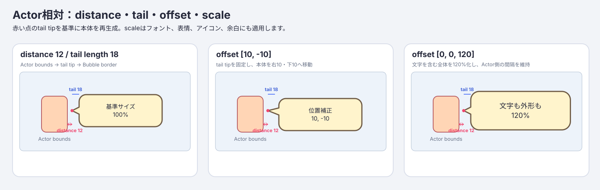

_図: `distance`はアクターの外枠からしっぽの先まで、`tailLength`は吹き出し本体からしっぽの先までの長さです。
`offset`は`[x, y]`または`[x, y, 倍率]`で位置と大きさをずらします。_

`portrait`の`blink`（目パチ）と`lipSync`（口パク）、`continueIndicator`（次へ進む合図）は、セリフの状態に
応じて動きが変わります。

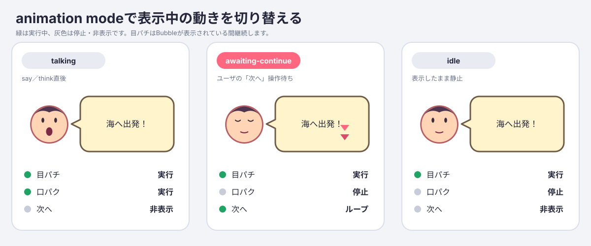

_図: セリフの表示中（talking）は目パチと口パク、読み手の入力待ち（awaiting-continue）は目パチと次へ進む合図、
表示したままの停止中（idle）は目パチだけが動きます。_

公開rc.41では、`portrait`へTurboWarp Bubbleと同じ`placement`、`offset`、`cornerRadius`を指定できます。
この3項目は省略可能で、省略すると既定値を使います。

<figure class="block-script-diagram">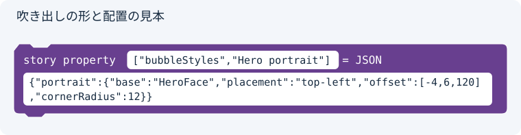</figure>

| field          | 指定できる値                                                                      | 省略時        |
| -------------- | --------------------------------------------------------------------------------- | ------------- |
| `placement`    | `left`、`right`、`top-left`、`top-right`、`bottom-left`、`bottom-right`           | `left`        |
| `offset`       | 吹き出し本体の`offset`と同じ`[x, y]`または`[x, y, 倍率]`。倍率は0より大きい百分率 | `[0, 0, 100]` |
| `cornerRadius` | 0以上の角丸半径                                                                   | `0`           |

これらの値は変換せずにTurboWarp Bubbleへ渡されます。

出典: [TurboWarp Bubble README](https://github.com/kubohiroya/turbowarp-bubble/blob/ad5b008e89f95c0182977f3e2e77d58fc2041b16/README.ja.md)
（固定commit `ad5b008`）。これら4図には[MPL-2.0](https://www.mozilla.org/MPL/2.0/)が適用されます。

styleには本文、終了条件、吹き出し開始時の音声を含めません。`text`、`closePolicy`、`seconds`、
`waitFor`、`startSound`はセリフ側の設定です。見た目の`bubbleStyles`と終了条件の
`bubbleClosePolicies`は別のregistryとして扱います。

吹き出しの設定は、次の三か所へ分けて書きます。

| 設定                                                                                                                        | `bubbleStyles` | `bubbleClosePolicies` | `Actor.say`／`Actor.think`       |
| --------------------------------------------------------------------------------------------------------------------------- | -------------- | --------------------- | -------------------------------- |
| 本文`text`、開始時の音`startSound`                                                                                          | ×              | ×                     | ○                                |
| 閉じる条件`seconds`、`waitFor`                                                                                              | ×              | ○                     | ○（`closePolicy`とどちらか一方） |
| 閉じる条件の名前`closePolicy`                                                                                               | ×              | ×                     | ○                                |
| 文字送り`characterIntervalSeconds`、`characterSound`、`noSoundCharacters`、`restCharacters`、`restCharacterIntervalSeconds` | ○              | ×                     | ○（styleの後に適用）             |
| 見た目`textStyle`、`placement`、`visualStyle`、`portrait`、`continueIndicator`、`reveal`、`audio`、各animationなど          | ○              | ×                     | ×（`styles`で名前を参照する）    |

`Actor.say`／`Actor.think`には、`closePolicy`、`seconds`、`waitFor`のどれかが必要です。

## 吹き出しを閉じる条件（bubble close policy）を設定する

同じ終了条件を複数の`Actor.say`／`Actor.think`で使う場合は、トップレベルの`bubbleClosePolicies`へ
名前を付けて定義し、actionの`closePolicy`で1件だけ参照します。

<figure class="block-script-diagram">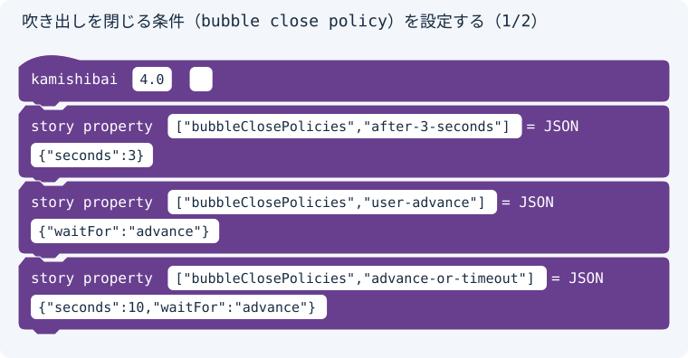</figure>

<figure class="block-script-diagram">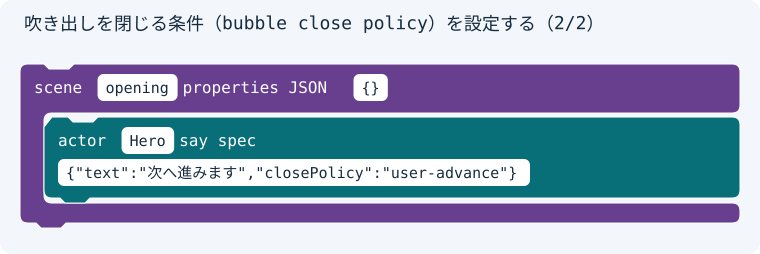</figure>

| 指定                       | 閉じる時点                                                        | 向いている場面                 |
| -------------------------- | ----------------------------------------------------------------- | ------------------------------ |
| `seconds`だけ              | 吹き出しの表示開始から指定秒数後                                  | 自動で進むナレーション         |
| `waitFor: advance`だけ     | Stageのprimary pointer／tapまたは修飾キーなしの任意キー入力のとき | 読み手のペースで進めるセリフ   |
| `seconds`と`waitFor`の両方 | 入力とtimeoutのうち先に成立した方                                 | 操作がなくても止まらない展示等 |

文字送りの途中で閉じる条件が成立した場合は、残りの本文を文字音と文字別の休止なしで即時表示してから閉じます。

policyの継承や合成はありません。`closePolicy`と、同じaction内の`seconds`／`waitFor`は併用できません。
未定義のpolicy名は`K4-REF-001`です。従来のinline指定は引き続き使えるので、一度しか使わない条件まで
無理に名前へ切り出す必要はありません。

runtimeはaction開始前にpolicyを既存の`seconds`／`waitFor`へ展開します。live reloadの途中ですでに表示中の
セリフは開始時に解決した値を使い続け、更新したpolicyは次に開始する物語の世代から適用されます。

## 変数と条件分岐を設定する

物語の途中で選択の結果を覚えておき、あとの場面で道を分けたい場合は、変数と分岐を組み合わせます。変数はトップレベルの`variables`で初期値を宣言し、分岐は`branches`で条件と移動先の組を登録してから、シーンの中で名前で呼び出します。

### 変数

<figure class="block-script-diagram">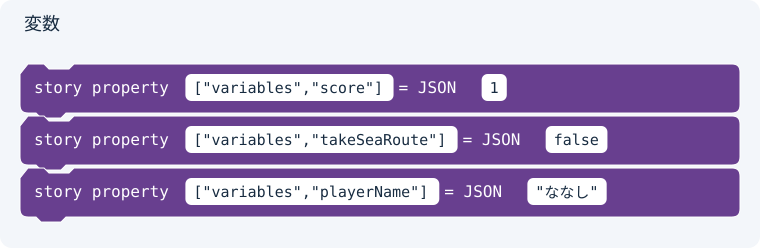</figure>

<figure class="block-script-form">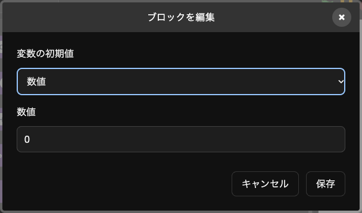</figure>

初期値に使用できる型はstring、number、booleanだけです。配列、オブジェクト、`null`、式を初期値には
使用できません。宣言時の型と異なる値へ暗黙変換しません。

実行中に値を変更するには、次のGlobal actionを使います。

<figure class="block-script-diagram">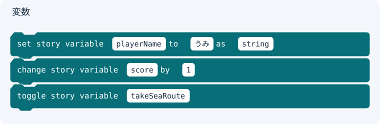</figure>

| action           | 対象の型                | 動作                                 |
| ---------------- | ----------------------- | ------------------------------------ |
| `setVariable`    | string／number／boolean | 宣言時と同じ型のリテラル値を代入する |
| `changeVariable` | number                  | `by`の数値を加える（負の数で減らす） |
| `toggleVariable` | boolean                 | 現在の値を反転する                   |

宣言していない変数は`K4-VARIABLE-WRITE-UNKNOWN`、型の違う値は`K4-VARIABLE-WRITE-TYPE`でactionが失敗します。
`score + 1`のような式は書けません。更新はactionが成功したときだけ確定し、cancel、skip、失敗で終わった
actionの更新は破棄されます。

`variables`は物語の意味を持つ値だけに使います。cameraの物理device ID、プレビューのボタンの選択状態、
DOM node、listener、Object URLはapp shell所有の一時状態であり、story変数やScratch変数へ写さないでください。

### 分岐

分岐は上から順に条件を評価し、最初に真になった移動先を選びます。最後の規則は必ず`else`にします。

<figure class="block-script-diagram">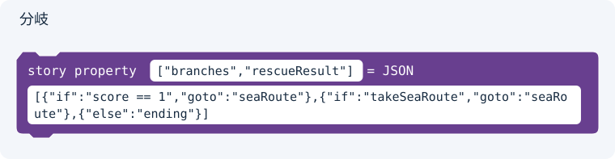</figure>

条件式はJSON文字列として記述します。`if`と`goto`は同じJSONオブジェクトへ書き、`else`は分岐内に一つだけ、末尾へ
置きます。すべての移動先シーンが定義済みでなければなりません。

4.0.0-rc.8では、条件式は`branch` action開始時点のトップレベル`variables:`を不変snapshotとして参照します。
ASCIIのbare nameは`score == 1`のように書けます。日本語や`-`などbare nameにできない文字を含む名前は、
`vars["救助回数"] >= 2`のように完全一致のstring literalで指定します。Stage／sprite変数、Temporary Variables、
`ポーズ認識`、`チャージ`は条件式へ自動では入りません。

シーンから分岐を実行します。

<figure class="block-script-diagram"></figure>

条件式の評価器と利用できる演算は、利用するreleaseのDSL 4.0機能一覧で確認してください。

## 操作キーを設定する

`controls`では、development用とproduction用など、実行環境ごとに完全なkeymapを定義できます。

<figure class="block-script-diagram">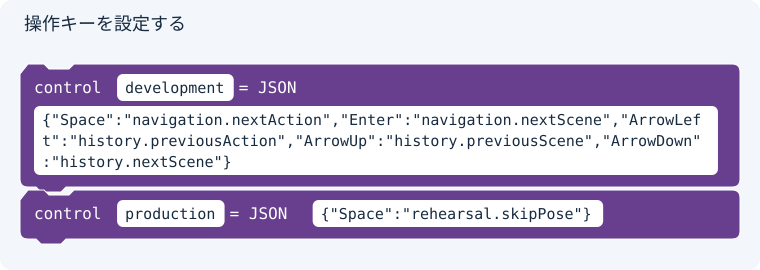</figure>

<figure class="block-script-form">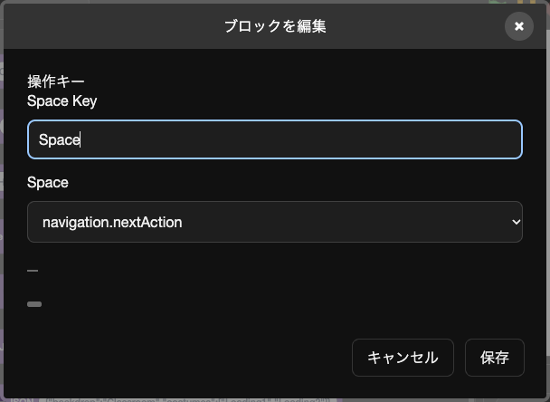</figure>

ビルダーは`controlProfile`を明示的に一つ選び、選択されたprofileのkeymapだけを有効にする設計です。
profile間の継承、merge、fallbackはありません。

使用できるnavigation commandは次の8個です。

| command                  | 動作                                   |
| ------------------------ | -------------------------------------- |
| `navigation.nextAction`  | 通常実行として次のアクションへ進む     |
| `navigation.nextScene`   | 通常実行として次のシーンへ進む         |
| `rehearsal.skipPose`     | 現在のpose stepを完了する              |
| `rehearsal.skipAction`   | 現在のactionを最終状態へ進める         |
| `rehearsal.skipScene`    | 現在のsceneを安全な最終状態へ進める    |
| `history.previousAction` | 実行履歴上の前のアクションへ移動する   |
| `history.previousScene`  | 実行履歴上の前のシーンの先頭へ移動する |
| `history.nextScene`      | 実行履歴上の次のシーンの先頭へ移動する |

キー名には`KeyboardEvent.code`を使用します。`Space`、`Enter`、方向キー、`Digit0`〜`Digit9`、
`KeyA`〜`KeyZ`、`Numpad0`〜`Numpad9`、`F1`〜`F12`などがschemaで列挙されています。
`Shift+Space`のようなmodifierとの組み合わせは使用できません。

選択profileに`history.*`が一つでもある場合だけ、時系列historyを有効にします。history移動で実行位置は
変わりますが、物語の変数や表示状態を完全に巻き戻す機能ではありません。同じ物理キーを`controls`と
作品内の`keyInputToChangeScene`へ重ねて割り当てないでください。

`rehearsal.skipPose`はpose action内の次stepへ進み、`rehearsal.skipAction`は現在のaction全体、
`rehearsal.skipScene`は現在のsceneを完了します。これらは実行履歴を移動しません。keymapへ明示したprofileで
だけ有効になります。

## シーンを書く

`scene`ブロックの名前入力へシーンIDを入れ、内側へ命令を並べます。シーン固有の設定は`PROPERTIES`へ入れます。DSL版の短形式・長形式は、ブロック版ではこの同じ構造になります。

### 基本のシーン

シーン固有の設定が不要なら、アクション列を直接書きます。

<figure class="block-script-diagram">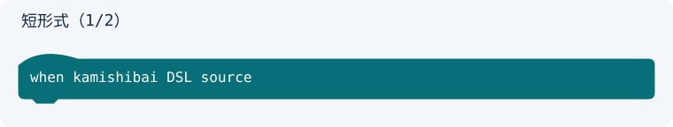</figure>

<figure class="block-script-diagram">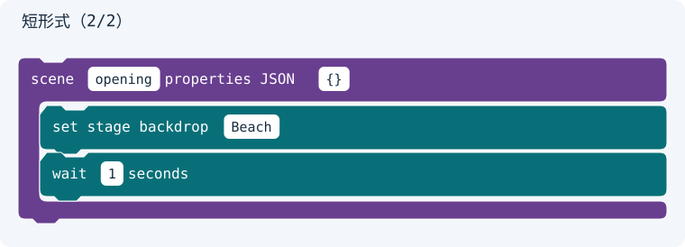</figure>

### シーン固有の設定

認識モデルなどのシーン固有設定は`scene`ブロックの`PROPERTIES`へJSONで入力します。

<figure class="block-script-diagram">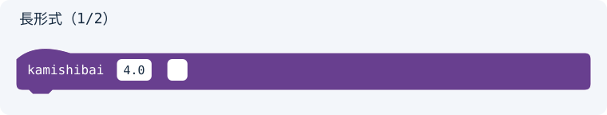</figure>

<figure class="block-script-diagram">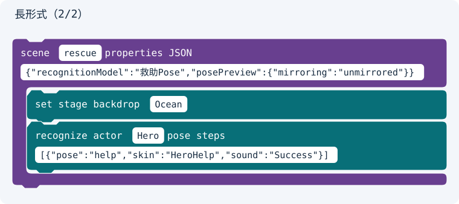</figure>

`PROPERTIES`には`recognitionModel`や`posePreview`を入れ、命令はC字の内側へ接続します。DSLへ書き戻す場合は、
アクションは必ず`actions`のlistへ入れます。`posePreview.mirroring`はそのsceneだけの上書きです。次に入る
sceneへ指定がなければstory既定へ戻り、前sceneの値を持ち越しません。DSL版の短形式と長形式は、検証後に同じ
内部の`SceneNode`へ正規化されます。

シーンの`PROPERTIES`には、ほかに次の設定を入れられます。

| 設定              | 値                   | 意味                                                                                    |
| ----------------- | -------------------- | --------------------------------------------------------------------------------------- |
| `recognitionMode` | `pose`または`image`  | `recognitionModel`をポーズ認識と画像認識のどちらに使うか。画像認識では`image`を明示する |
| `entryTransition` | 秒数または切り替え方 | このシーンへ入るときの画面の切り替え方。`presentation.transitions.scene`より優先する    |

画像認識でシーンを選ぶ例です。

<figure class="block-script-diagram">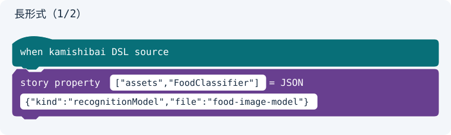</figure>

<figure class="block-script-diagram">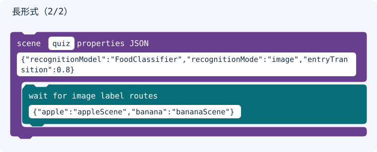</figure>

最初の開始、restart、rehearsal、履歴移動、live reloadでは、`entryTransition`を指定していてもcrossfadeしません。

### sceneの記述順を保つ

ハットからつながる`scene`の順番が、通常実行のシーン順です。最初のシーンから開始し、
`goto`、`branch`、入力命令が別のシーンを選ばない限り、次につながるシーンへ進みます。
[「次に実行するシーンの決まり方」](#次に実行するシーンの決まり方)も参照してください。

シーンを移動するときは、C字のまとまり全体と、前後の接続を確認します。改名した場合は、
`goto`や`ROUTES`内の参照先も直します。保存・書き戻しのあとも順番が変わらないことを確認してください。

現行の共通frontendには数字だけのシーンIDで順番を保証できない制約があります。
修正されるまでは`scene10`、`scene2`のように数字以外を含む名前を使います。

## 舞台への命令（Global action）

Global actionはアクター名を付けずに記述します。

| action                    | 短形式または主な引数           | 役割                              |
| ------------------------- | ------------------------------ | --------------------------------- |
| `stage`                   | 背景ID                         | 背景を変更する                    |
| `bgm`                     | 音ID                           | BGMの再生を依頼する               |
| `stopBgm`                 | なし、またはfade-outの秒数     | BGMを止める                       |
| `setBgmVolume`            | 0〜100の音量                   | BGMの音量を変える                 |
| `sound`                   | 音ID                           | 効果音の再生を依頼する            |
| `wait`                    | 0以上の秒数                    | 指定時間待つ                      |
| `debugger`                | `null`                         | development debugの停止境界を置く |
| `broadcastMessageAndWait` | message名                      | message receiverの完了を待つ      |
| `transition`              | `effect`、`seconds`            | 見た目の遷移効果を実行する        |
| `goto`                    | シーンID                       | 指定シーンへ移動する              |
| `branch`                  | 分岐ID                         | 条件分岐を評価して移動する        |
| `setVariable`             | `name`、`value`                | 変数へ値を代入する                |
| `changeVariable`          | `name`、`by`                   | 数値の変数へ値を加える            |
| `toggleVariable`          | 変数名                         | 真偽値の変数を反転する            |
| `keyInputToChangeScene`   | キーからシーンへのmapping      | キー入力を待って移動する          |
| `touchInputToChangeScene` | アクターからシーンへのmapping  | タッチ入力を待って移動する        |
| `poseInputToChangeScene`  | ポーズからシーンへのmapping    | 最初に認識したポーズで移動する    |
| `imageInputToChangeScene` | 画像classからシーンへのmapping | 最初に認識した画像classで移動する |

### 背景、音、待機

<figure class="block-script-diagram"></figure>

`wait`は0以上です。背景と音のIDは、使用箇所に合う`kind`のアセットを参照します。

### 切り替え方を指定する

`dsl4CrossfadeTransitions`が有効なruntimeでは、シーン、背景、アクターのコスチュームと表示、BGMを
crossfadeで切り替えられます。作品全体の既定値はトップレベルの`presentation`と`audio`へ書きます。

<figure class="block-script-diagram"></figure>

個々のactionの`transition`は既定値より優先します。

<figure class="block-script-diagram"></figure>

<figure class="block-script-diagram"></figure>

<figure class="block-script-diagram"></figure>

<figure class="block-script-diagram"></figure>

| 書き方                                 | 意味                                                                   |
| -------------------------------------- | ---------------------------------------------------------------------- |
| 秒数（例: `0.4`）                      | その秒数でcrossfadeする。`0`は切り替えるだけ（`cut`）                  |
| `{effect: cut}`                        | すぐに切り替える                                                       |
| `{effect: crossfade, seconds, easing}` | 画面の切り替え。`easing`は`linear`か`easeInOut`（省略時は`easeInOut`） |
| `{effect: crossfade, seconds, curve}`  | BGMの切り替え。`curve`は`linear`か`equalPower`（省略時は`equalPower`） |

秒数は0〜60です。指定しなかった項目は`cut`になるため、既存の台本の見た目とtimingは変わりません。
crossfadeを明示的にOFFにしたruntimeでは、`transition`を含む台本を`K4-TRANSITION-FLAG-001`で実行前に拒否します。

### BGMを止める、音量を変える

<figure class="block-script-diagram"></figure>

<figure class="block-script-diagram"></figure>

`volume`は0〜100です。`setBgmVolume`は再生中のBGMの音量を変え、`seconds`を指定するとその時間で
線形に変化させます。`stopBgm`は再生中のBGMを止め、秒数を指定するとその時間でfade-outしてから止めます。
`stop BGM over`の秒数を`0`にするとすぐに止めます。fade中は完了を待ってから次のactionへ進みます。

BGMが鳴っていないときの`stopBgm`と`setBgmVolume`は何もしません。次に鳴るBGMの音量として覚えておくことも
ありません。fade-inは、BGMが鳴っていない状態で`bgm`へcrossfadeの`transition`を指定すると得られます。
同じBGMが鳴っている間の`bgm`は、`restart: true`を指定しない限り何もしません。BGMのloop指定は4.0ではできません。

### 動画を表示・操作する

公開済みのrc.37では、`video` でID付きの矩形領域を表示し、`videoControl` で再生・停止などを操作できます。
台本の版は4.0のままです。Standard SB3と制作プレビューで標準ONのため、有効化用URLパラメータは不要です。
背景／前面を選ぶ `plane` と、同じ面での重なり順を決める `zIndex` も指定できます。
このガイドの固定基準rc.25から追加された動画について、[動画再生ガイド](../dsl-author-guides/dsl-4.0-video-guide.md)で対応実装、入力欄、使い方と制約を説明します。

### debug停止とTurboWarp message

<figure class="block-script-diagram"></figure>

<figure class="block-script-diagram"></figure>

`debugger`はdevelopment debug実行でaction開始前に停止する境界です。引数やactor prefixは指定できません。
production／埋め込み作品では副作用のないno-opとして直ちに完了します。

`broadcastMessageAndWait`はScratch／TurboWarpの「メッセージを送って待つ」に相当します。指定messageで開始した
receiver threadがすべて終了してから次actionへ進みます。終了しないreceiverを持つmessageには使用しないでください。

### 画面効果

<figure class="block-script-diagram"></figure>

`transition`は見た目の効果だけを実行し、シーンを移動しません。移動が必要なら、次に`goto`または
`branch`を書きます。`effect`は識別子であり、実際に利用できる効果名はTurboWarp接続側の実装契約で
確定します。

### シーン移動

<figure class="block-script-diagram"></figure>

参照するシーンまたは分岐は、同じ台本内で定義済みでなければなりません。

### キー入力による移動

<figure class="block-script-diagram"></figure>

`stableId`を付ける場合は、命令を`action options`で囲み、`PROPERTIES`の`arguments.stableId`へ指定します。経路は命令側の`ROUTES`へ残します。

<figure class="block-script-diagram"></figure>

### タッチ入力による移動

<figure class="block-script-diagram"></figure>

左側には登録済みアクター、右側には登録済みシーンを指定します。

### 次に実行するシーンの決まり方

シーンの中ではアクションを上から順に実行します。移動するアクションを実行するとその移動先へ、移動しないまま
アクションがなくなると`scenes`に書いた次のシーンへ進みます。

_図: 移動先を決めるのは、移動するアクションと`scenes`の記述順の二つだけです。`transition`は画面効果だけで、
シーンを移動しません。_

| アクション                | 移動先の決め方                                                                         | 移動する前に待つもの |
| ------------------------- | -------------------------------------------------------------------------------------- | -------------------- |
| `goto`                    | 書いたシーンID                                                                         | なし                 |
| `branch`                  | `branches`の規則を上から評価し、最初に成立した`if`の`goto`、どれも成立しなければ`else` | なし                 |
| `keyInputToChangeScene`   | 押されたキーに対応するシーン                                                           | キー入力             |
| `touchInputToChangeScene` | タッチされたアクターに対応するシーン                                                   | タッチ入力           |
| `poseInputToChangeScene`  | 最初に認識したポーズに対応するシーン                                                   | ポーズ認識           |
| 移動するアクションなし    | `scenes`の記述順で次のシーン。最後のシーンなら物語が終了する                           | シーンの全アクション |
| `transition`              | 移動しない。続けて`goto`または`branch`を書く                                           | 画面効果の秒数       |

## 登場人物への命令（Actor action）

Actor actionは`actor`または`TARGET`の入力欄で対象のアクターを指定します。表の`Actor.command`はDSL版との対応名です。

| action                     | 必須引数                                          | 役割                                       |
| -------------------------- | ------------------------------------------------- | ------------------------------------------ |
| `Actor.show`               | `skin`、`x`、`y`、`scale`                         | コスチューム、位置、倍率を指定して表示する |
| `Actor.hide`               | なし                                              | アクターを非表示にする                     |
| `Actor.setTransparency`    | 0〜100または`from`、`to`、`seconds`               | 幽霊効果を即時設定または線形に変化させる   |
| `Actor.moveTo`             | `x`、`y`、`seconds`                               | 任意のeasingで指定位置へ移動する           |
| `Actor.say`／`Actor.think` | `text`と、`closePolicy`または`seconds`／`waitFor` | セリフまたは思考を表示する                 |
| `Actor.setSkin`            | コスチュームID                                    | コスチュームを変更する                     |
| `Actor.setLayer`           | `front`／`back`／相対layer数                      | アクターの重なり順を変更する               |
| `Actor.loop`               | `steps`                                           | コスチューム列を繰り返す                   |
| `Actor.setText`            | `text`、`style`                                   | SVG Textを更新する。rubyも書ける           |
| `Actor.pose`               | `steps`                                           | ポーズを順に認識してcostumeと音を適用する  |

### 表示する

<figure class="block-script-diagram"></figure>

`scale`は0より大きい数値です。`skin`は、そのアクターを`target`とするコスチュームアセットを
指定します。

### 非表示にする

<figure class="block-script-diagram"></figure>

visible stateをfalseにします。透明度effectとは別で、次の`Actor.show`が同じactorを再表示します。

### 透明度を変える

即時設定では0〜100の数値を直接指定できます。

<figure class="block-script-diagram"></figure>

`0`は完全不透明、`50`はScratch／TurboWarpの「幽霊の効果を50にする」、`100`は完全透明です。
値の反転や換算は行いません。`stableId`を付ける場合は名前付きの`transparency`形式を使います。

<figure class="block-script-diagram"></figure>

`from`、`to`、`seconds`を指定すると、透明度を線形に変化させます。

<figure class="block-script-diagram"></figure>

`background`を省略するか`false`にすると完了まで待ち、`true`では`from`を同期適用した直後に
次actionへ進みます。途中でskip、停止、再開始、破棄された場合や、同じactorへ次の透明度変化を始める場合は、
先の変化を`to`へ確定してtimerを回収します。

### 移動する

<figure class="block-script-diagram"></figure>

`seconds`は0以上です。`easing`は`linear`、`easeIn`、`easeOut`、`easeInOut`から選び、省略時は
`linear`です。XとYへ同じ補間率を使い、0秒、完了、skip時は指定した終点へ確定します。

### セリフと思考を表示する

<figure class="block-script-diagram"></figure>

`closePolicy`はトップレベルの`bubbleClosePolicies`に定義した名前です。`seconds`だけなら表示開始から指定秒数後、
`waitFor: advance`だけならprimary pointer／tapまたは有効な任意キーの入力後に完了します。
policyまたはinlineで両方を指定すると、入力とtimeoutのうち先に成立した方で完了します。
speech開始に使った同じ入力、interactive UI、IME composition、modifier shortcut、key repeatは
advanceとして再利用しません。

一度だけ使う終了条件は従来どおりinlineにも書けます。

<figure class="block-script-diagram"></figure>

`styles`には`bubbleStyles`の名前を1件以上のJSON配列で指定します。記載順に合成し、最後にaction内の
文字送りfieldを適用します。同じstyleの重複、未定義style、単数形`style`はエラーです。styleを使わない
inline形式も使用できます。

<figure class="concept-flow"><figcaption>セリフに使うstyleを合成する順序（後の段階ほど優先）</figcaption>
<code>styles</code>の1件目 例: <code>Typing</code><b aria-hidden="true">→</b><code>styles</code>の2件目以降 記載順に上書き。例: <code>Hero style</code><b aria-hidden="true">→</b>action内の文字送りfield 例: <code>characterIntervalSeconds: 0.1</code><b aria-hidden="true">→</b>このセリフで使うstyle

<strong>各styleの中身:</strong> 定義内の<code>styles</code>を記載順に合成し、その定義自身の値で上書きした結果を一つのstyleとして重ねます。同じ項目は後から重ねた値が使われます。
</figure>

`startSound`は吹き出し表示開始時に1回再生し、speech完了、入力、timeout、cancelで停止します。
文字送り途中に入力またはtimeoutした場合は、残り全文を文字音と文字別休止なしで即時表示して完了します。
`Actor.say`と`Actor.think`は同じlifecycleを使い、吹き出しの種類だけが異なります。

### コスチュームを変える

<figure class="block-script-diagram"></figure>

`stableId`を付ける場合は名前付き形式を使用します。

<figure class="block-script-diagram"></figure>

`scale`を指定すると、costumeを適用した後に正のサイズ百分率を設定します。

### 重なり順を変える

<figure class="block-script-diagram"></figure>

`front`／`back`は絶対位置、正の数値は前方、負の数値は後方への相対移動です。

### コスチュームを繰り返す

<figure class="block-script-diagram"></figure>

先頭skinを直ちに適用し、各秒数後に次のskinへ進むbackground loopです。少なくとも一つの`seconds`は
0より大きくします。同じactorの`setSkin`、runtime停止、environment破棄でloopを終了します。

### SVG Textを更新する

<figure class="block-script-diagram"></figure>

ルビを付ける場合は、`text`を文字列と`ruby`の並びにします。

<figure class="block-script-diagram"></figure>

並びは書いた順のまま表示し、隣り合う文字列をつなげたり前後の空白を削ったりしません。`base`と`reading`は
空にできません。backlogや読上げへ渡す文字列には`base`だけが残ります。`Actor.say`と`Actor.think`の`text`は
文字列だけで、rubyはまだ使えません。

### ポーズを認識する

<figure class="block-script-diagram"></figure>

`steps`は一つ以上必要です。各項目は、順に認識する`pose`、認識後に表示する`skin`、再生する`sound`を
一組として持ちます。シーンの`PROPERTIES`で`recognitionModel`も指定してください。

## 再読み込みに備えて`stableId`を付ける

`stableId`は、台本のlive reloadで変更前後の同じアクションを特定するための任意IDです。通常の台本で
すべてのアクションへ付ける必要はありません。付ける場合は文書全体で一意にします。

<figure class="block-script-diagram"></figure>

`action options`の`PROPERTIES`に`{"arguments":{"stableId":"waitBeforeEnding"},"textFormat":"plain"}`を入れ、内側へ待機ブロックを一つ接続します。

## この部分を使う［オン／オフ］

台本の一部を残したまま試さずにおきたいときは、C字型の「この部分を使う［オン／オフ］」で囲みます。
YAMLの行頭に`#`を付けて一時的に外す操作に対応します。複数の行に相当するブロックも一度に切り替えられます。

公開rc.46のCLIとStandard SB3は、本体[PR #903](https://github.com/kubohiroya/turbowarp-kamishibai-app/pull/903)の
オン／オフに対応しています。Editorを開き直すだけでは編集用ブロックは増えません。
[対応するCLI・ランタイムの準備と往復手順](../dsl-author-guides/dsl-4.0-block-script-conversion-guide.md#section-roundtrip)で
`author-block-dsl --block-sections true`を指定して生成したSB3を使います。パレット表示は既定OFFです。
旧rc.23のベースは読み取りに対応しません。直接再生にはrc.41のランタイムを使います。
図の専用グレー・絵文字セレクタ・オフ範囲の灰色表示は、[本体PR #909](https://github.com/kubohiroya/turbowarp-kamishibai-app/pull/909)の
表示改善を含むCLIで生成したSB3の画面です。公開rc.41にもこの表示改善が含まれます。
[公開CLIでの生成手順](../dsl-author-guides/dsl-4.0-block-script-conversion-guide.md#section-appearance-cli)を参照してください。
以前に生成した公開サンプルなどのSB3は、Editorを再読み込みするだけでは新しい表示になりません。
元のYAMLまたはSB3から書き戻したYAMLを、対応CLIで再生成します。台本のオン／オフの意味は同じです。

### 命令を囲んで切り替える

1. 対応SB3をExtension Data Editorで開き、ステージの「コード」を選びます。編集用拡張の読み込みも許可します。
2. 「Kamishibai Block Script」からグレーの「この部分を使う」を取り出し、`scene`の内側へ接続します。
3. 一時的に外したい命令をC字の内側へ移します。続けて実行する命令は囲みの下につなぎます。
   複数命令を移すときは、その後も実行する末尾の命令を先に切り離してください。
4. メニューを「🚫 オフ」にすると内側を読み飛ばし、「✅ オン」に戻すと内側をその位置で実行します。
5. SB3をコンピューターへ保存し、物語を開始し直して確認します。実行中の切り替えを自動反映する機能ではありません。

<figure class="block-script-form"><figcaption>プルダウンから「✅ オン」「🚫 オフ」を選びます。値や条件式を入力する必要はありません。</figcaption></figure>

次の例は、1秒・2秒・3秒の待機のうち、2秒だけを囲んでいます。図は切り替え部分を示しています。
再生する台本には、`production`のキーマップなど必要な設定も用意してください。

<figure class="block-script-form"><figcaption>オン: 1秒 → 2秒 → 3秒の順に実行します。</figcaption></figure>

<figure class="block-script-form"><figcaption>オフ: 1秒 → 3秒の順に実行します。2秒の命令は囲みの中に残ります。</figcaption></figure>

本体はオン／オフともグレーです。「🚫 オフ」では、C字の内側に明るい灰色の斜線背景と破線の境界が現れ、
囲まれた命令・定義・入力ブロックも灰色になります。囲みの下につないだ命令は元の色を保ちます。灰色の部分も編集でき、SB3にはそのまま残ります。
「✅ オン」に戻すと内側の色と背景が戻ります。囲み外へ移したブロックも元の色へ戻り、元に戻す・やり直すにも追従します。
入れ子では外側のオフが優先するため、内側がオンでも外側のオフ範囲に含まれるブロックは灰色です。
これは編集を助ける表示で、通常のScratchの「ブロックを無効化」とは別の仕組みです。
オフ部分を削除したり、通常のScratchの「もし」ブロックで囲んだりする必要はありません。

### 定義にも使う

`asset`や`actor`などの定義を外すときは、台本ハット直下の定義列に囲みを置き、定義ブロックを中へ移します。
定義をオフにする場合は、それを参照する命令・定義も外すか、別の有効な定義へ参照を変更します。
有効部分から無効な素材などを参照すると診断になります。同じ名前の候補を並べる場合は片方だけをオンにします。

囲めるのは定義列、または`scene`内の命令列です。`scene`全体と`includeBlocks`は囲めません。
入れ子は最大32段で、外側がオフなら内側がオンでも実行されません。
オフ部分でも、接続・循環・JSON構文・基本型を検査します。内部のSchema制約と素材参照などの意味検査は、
オンにしたときに行います。オフは壊れた接続や不正JSONを隠す指定ではありません。

### 保存とYAMLへの書き戻し

SB3には、囲んだブロックとオン／オフの選択値が残ります。対応CLIでYAMLへ書き戻すと、実行する部分を
通常の台本、オフ部分と囲み構造を`# kamishibai-block-sections-v1:`で始まる復元用コメントへ保存します。
対応CLIで再生成すれば元の囲みを復元できます。元のYAMLの各行へ`#`を付け直す方式ではありません。

YAMLの本文だけを独立に変更すると、再生成時に編集状態との不一致を診断します。
YAMLの直接編集へ移る場合は、編集用SB3を退避してから復元用コメントを削除します。
そのYAMLからは、オフ部分と囲み構造を復元できなくなる点に注意してください。
詳細は[相互変換ガイド](../dsl-author-guides/dsl-4.0-block-script-conversion-guide.md#section-roundtrip)を参照してください。

## 編集したブロックを保存・検査・再生する

1. 素材bundleを含むブロック台本SB3をTurboWarpで開き、台本ハットからつながるブロックを変更する
2. 緑の旗で起動してタイトルを閉じ、空名ルートから変更後の物語が始まることを確認する
3. ファイルメニューから`story-edited.sb3`としてコンピューターへ保存する
4. 同じ公開rc.46のCLIで`export-block-dsl`を実行し、書き出したYAMLを検査する
5. file素材の追加・パス変更・内容変更がある場合だけ、書き出した最新YAMLを元の素材フォルダーに置き、
   編集後SB3を`--base`、そのYAMLを`--source`へ明示指定して`build-dsl4`でbundleを更新する

コマンドの具体例は[ブロック版チュートリアル](../tutorials/create-blocks.md)を参照してください。
図のシーン順、入力値、ブロックの接続が保存・書き戻しで保持されることを確認します。
実行中にブロックを編集しても自動監視はしません。物語を開始し直すと現在のブロックを読み直します。
外部YAML用Web Previewと、SB3内の台本ブロックの再読込は別の経路です。

不正な台本は診断を表示し、古い台本やファイル選択へ自動で切り替えません。
参照名を変えた場合は対応する設定と命令を揃え、元のSB3・編集後SB3・素材の元ファイルを保持してください。

## 総合サンプル

公開rc.25に対応した[チュートリアル完成版のブロック台本SB3](https://kubohiroya.github.io/turbowarp-kamishibai-samples/stories/tutorial/tutorial-blocks-4.0.sb3)と
[浦島太郎のブロック台本SB3](https://kubohiroya.github.io/turbowarp-kamishibai-samples/stories/urashima/urashima-blocks-4.0.sb3)には素材bundleが同梱されています。
Editorで開き、緑の旗で起動してタイトルを閉じると、組み込まれた物語を再生できます。

次の例は、アセット、表紙、SVG Text、bubble style、変数、keymap、分岐、入力、ポーズ認識を一つの台本へ
まとめたものです。利用するreleaseでDSL 4.0と必要な機能フラグを有効にして実行します。

<figure class="block-script-diagram"></figure>

<figure class="block-script-diagram"></figure>

<figure class="block-script-diagram"></figure>

<figure class="block-script-diagram"></figure>

<figure class="block-script-diagram"></figure>

<figure class="block-script-diagram"></figure>

<figure class="block-script-diagram"></figure>

<figure class="block-script-diagram"></figure>

<figure class="block-script-diagram"></figure>

<figure class="block-script-diagram"></figure>

<figure class="block-script-diagram"></figure>

<figure class="block-script-diagram"></figure>

<figure class="block-script-diagram"></figure>

## 診断と安全停止

ブロックの接続・JSON・台本の構造・参照関係を検査してから、素材の準備と実行へ進みます。
不正な台本を元のYAMLへ黙って戻すことはありません。ブロックを修正してSB3を保存し直し、再実行します。

| 表示                                | 確認すること                                                            |
| ----------------------------------- | ----------------------------------------------------------------------- |
| `K4-BLOCK-SOURCE-MISSING-001`       | 主台本の宣言ハットがあるか。実行専用SB3を選んでいないか                 |
| `K4-BLOCK-SOURCE-GRAPH-001`         | シーンの接続、重複、対応する命令ブロック、入力欄                        |
| `K4-BLOCK-SOURCE-FRAGMENT-001`      | JSONの引用符・カンマ・括弧                                              |
| `K4-BLOCK-SOURCE-VERSION-001`       | ハットの版入力が文字列`4.0`か                                           |
| `K4-BLOCK-SOURCE-LABEL-001`         | 参照ラベルが空欄・未定義でないか                                        |
| `K4-BLOCK-SOURCE-DUPLICATE-001`     | ラベル・入口・出力名が重複していないか                                  |
| `K4-BLOCK-SOURCE-CYCLE-001`         | includeBlocksが自己参照・循環していないか                               |
| `K4-BLOCK-SOURCE-SECTION-STATE-001` | オン／オフの復元用コメントとYAML本文が一致するか。対応CLIを使っているか |
| `K4-VERSION-001`                    | 版の設定値が数値でなく文字列の`"4.0"`か                                 |
| `K4-SCHEMA-*`                       | 項目、値の型、必須入力、範囲                                            |
| `K4-REF-*`                          | 素材、シーン、アクターなどの参照先                                      |
| `K4-STABLE-ID-001`                  | 安定IDが重複していないか                                                |
| `K4-BRANCH-001`                     | 分岐の最後に一つだけ`else`があるか                                      |

診断のブロックIDやStory Pathを使って該当箇所を特定します。書き戻したYAMLの行番号は、
ブロック画面の座標ではありません。実行中のエラーには`K4-RUNTIME-*`も使用します。

## 作成時のチェックリスト

- [ ] 公開rc.41の同じCLIで生成・書き戻し・検査した
- [ ] Stageの名前が空のルートが1個あり、名前付きモジュールへの参照・シーンがつながっている
- [ ] ハットの版入力が文字列`4.0`で、ラベルと参照先が一致している
- [ ] 各命令がシーンの内側につながり、順番が正しい
- [ ] `NAME`は名前だけを入力し、`VALUE`、`SPEC`、`ROUTES`、`STEPS`のJSONが正しい
- [ ] `cover`、`loading`、`recognition`は各1個で、定義の重複がない
- [ ] 背景・衣装・音・モデルの種別と、衣装の対象アクターが正しい
- [ ] 使うシーン・素材・スタイル・変数・分岐をすべて定義した
- [ ] キー入力が操作用キーと衝突しない
- [ ] 安定IDは台本全体で重複しない
- [ ] file素材のbundleを揃え、更新前SB3・編集後SB3・外部素材を保持した
- [ ] 保存・書き戻し・検査のあと、ブロック台本SB3を開始し直して先頭から最後まで確認した

## 付録: 図版と実装の対応

図版は台本DSL版のYAML例から生成した接続と入力値を基に、Issue #883の統一ハットと
Issue #886の種類別定義ブロックへ更新しています。
ブロック定義の確認基準は本体commit `33594634ff19aebcde596c8be05730c0817b5ac6`です。
図版の再生成元は`sources/dsl4-authoring-blocks.json`、描画スクリプトは
`scripts/render-authoring-blocks.mjs`です。図の配置や配色は説明用で、生成SB3の画面位置とは異なります。
ブロック名、入力欄、C字の内側の命令は実装と対応します。
フォームの実装基準は本体commit `0c1bf09f3285e1ea265037926a3465e550ab46c8`です。
撮影条件・入力値・検証結果は`sources/dsl4-definition-forms.json`に記録しています。

オン／オフの動作基準は本体commit `0f1654573ccb517805fe6512ca45e64bd471d163`です。
グレー表示・絵文字メニューの図版は本体PR #909のcommit `1c11ceffdaf880a8bbd31bd355d9c94363223354`を基にしています。
実画面の撮影条件・命令列・検証結果は`sources/dsl4-source-sections.json`に記録しています。

公開状況やruntime側の実装根拠は[台本DSL版の付録](../dsl-author-guides/dsl-4.0-author-guide.md#付録-実装基準と実装根拠)を参照してください。

## 関連資料

- [紙芝居DSL 4.0 Schemaリファレンス](../dsl-author-guides/dsl-4.0-schema-reference.md): 固定Schemaに基づくfield、型、制約、action一覧
- [DSL 4.0ランタイム変数ガイド](../dsl-author-guides/dsl-4.0-runtime-variable-guide.md): 実行中に参照できる変数と、その扱い方
- [3系作品の変換ガイド](../dsl-author-guides/dsl-3.2-to-4.0-conversion-guide.md): 3系の台本を4.0のYAMLへ変換する手順
- [紙芝居DSL 4.0 リリース履歴](../dsl-author-guides/dsl-4.0-history.md): 版ごとの追加機能と変更点
- [DSL 4.0表層仕様](https://github.com/kubohiroya/turbowarp-kamishibai-app/blob/450a5bb950ef769241ec8258690e652b39b23bde/docs/design/dsl-4-surface.md): 4.0の規範的な作者向け構文
- [DSL 4.0 JSON Schema](https://github.com/kubohiroya/turbowarp-kamishibai-app/blob/450a5bb950ef769241ec8258690e652b39b23bde/schema/dsl-4.schema.json): 機械可読な構造仕様
- [DSL 4.0 include文の複数ファイル対応](https://github.com/kubohiroya/turbowarp-kamishibai-app/blob/450a5bb950ef769241ec8258690e652b39b23bde/docs/design/dsl-4-source-include-preview.md): include、transaction、有限上限、rollback
- [DSL 4.0 ポーズoverlay実装 Issue #624](https://github.com/kubohiroya/turbowarp-kamishibai-app/issues/624): Schema、TurboWarp Teachable Machine 1.12.0 composition API mapping、YAML opt-in、rollback
- [DSL 4.0総合fixture](https://github.com/kubohiroya/turbowarp-kamishibai-app/blob/450a5bb950ef769241ec8258690e652b39b23bde/test/fixtures/dsl4/valid/comprehensive.kamishibai.yaml): schemaと意味検証を通る総合例

## rc.39の音声再生

4.0.0-rc.41では、`audio`で停止状態の音声をIDへ準備し、`audioControl`で個別に再生・停止・一時停止・再開・シーク・音量・ミュート・速度を操作できます。再生時は`fadeIn`・`volume`・`fadeOut`、停止時は`fadeOut`を指定できます。音量は100が既定で0以上の有限数、100超は増幅です。

対応するブロックは次の2つです。空の追加入力は省略・継承を表します。

- `prepare audio [ID] from [SOURCE_TYPE] [SOURCE] fade in [FADEIN] seconds volume [VOLUME] % fade out [FADEOUT] seconds`
- `audio [ID] [OPERATION] value [VALUE] fade in [FADEIN] seconds volume [VOLUME] % fade out [FADEOUT] seconds`

旧BGM/SEの命令と寿命・crossfadeは維持します。scene単位の新しい音声IDと、sceneを跨ぐ旧BGMは寿命が異なるため、既存作品のBGMを一律に置換しません。詳細は[音声再生ガイド](../dsl-author-guides/dsl-4.0-audio-guide.md)を参照してください。

## DSL 4.0 RC改訂の物語反復と条件分岐

`if`／`repeat`／`forEach`の専用囲み、型付き参照、各回の一覧表は、App 4.0.0-rc.44以降のStandardで利用できます。
[作者ガイドの4.0 RC改訂仕様](../dsl-author-guides/dsl-4.0-author-guide.md)に構文・一覧編集・上限・中断・切戻しをまとめました。
宣言は4.0のままです。rc.43以前は対応しないため、ベースSB3・台本・CLIの対応版を揃えます。
Standardは起動時固定で物語制御を有効にします。低水準APIの既定OFFと明示的な無効化は維持します。
通常の対応CLIで変換・検証・build・previewでき、追加の実験flagは不要です。旧runnerとの混在は拒否します。現在の公開版は4.0.0-rc.46です。[npmの同一版](https://www.npmjs.com/package/@kubohiroya/turbowarp-kamishibai-app/v/4.0.0-rc.46)のCLIと、同じrc.46のベースSB3を使います。
標準Scratch制御ブロックは引き続き非対応です。

[三人の訪問](https://kubohiroya.github.io/turbowarp-kamishibai-samples/stories/three-visits/)で、公開Editorの一覧フォーム・保存／キャンセル・再生を試せます。非対応ブロックの診断には日本語名・ステージ／スプライト名を表示し、該当箇所へ移動・強調できます。
