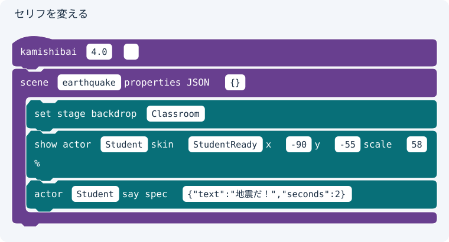
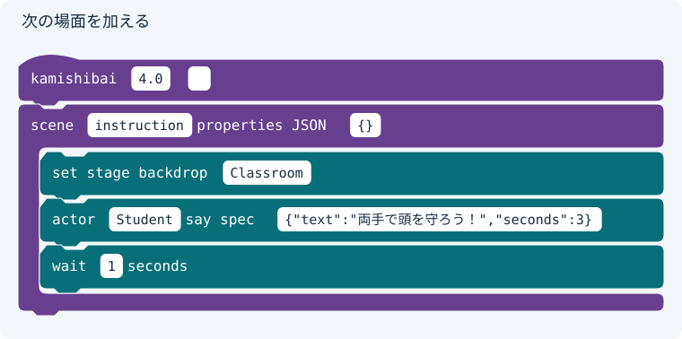
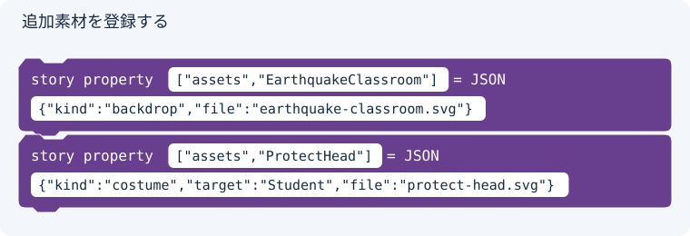
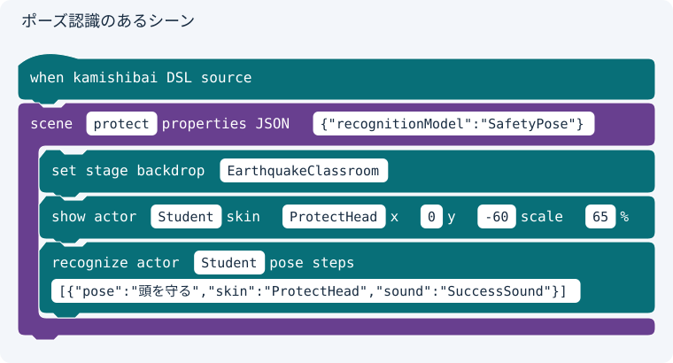

# 紙芝居を作る

Copyright © 2026 Hiroya Kubo. この文書は[CC BY-SA 4.0](https://creativecommons.org/licenses/by-sa/4.0/)で提供します。

対象: 初めて台本ブロックで紙芝居を作る方\
扱う台本: TurboWarp上のブロック台本SB3\
実装基準: 公開プレリリース`4.0.0-rc.23`、2026年10月19日\
スターターとベースSB3: 公開プレリリース`4.0.0-rc.23`

入口: [TurboWarp紙芝居 4.0 ドキュメント](https://kubohiroya.github.io/turbowarp-kamishibai-docs/4.0/)

このチュートリアルは、[台本DSL版「紙芝居を作る」](create.md)と同じスターターを、台本ブロックで編集する実習です。
最初にセリフを変え、次の場面を加え、検査して配布用SB3を作ります。最初のセリフ変更ができてから、背景やポーズへ進みます。
SVGのブロック図は入力欄と接続を基に描いた説明図、PNGのフォーム図は実Editorの画面キャプチャです。狭い画面では図を左右にスクロールできます。

## 利用する版を先に確認する

公開rc.23には、命令単位のブロック編集、8種類の専用定義ブロック、フォーム編集、
組み込み台本からの直接再生が含まれます。正式版4.0.0は未公開です。
Node.js 24.0.0以上で作業用フォルダーに公開CLIを版固定してインストールします。
本体リポジトリのcheckoutや`build:lib`は不要です。

```sh
npm install --save-dev --save-exact @kubohiroya/turbowarp-kamishibai-app@4.0.0-rc.23
npx --no-install turbowarp-kamishibai --version
```

表示が`4.0.0-rc.23`であることを確認します。以後のコマンドはすべて、この作業用フォルダーで実行します。
古い編集用SB3の埋込拡張は自動更新されません。統一ハットの台本は公開rc.23でYAMLへ書き戻して再生成し、
旧ハットやYAML全文の文字列方式のSB3は元YAMLから再生成してください。
準備済みの素材入りブロック台本SB3が配られた場合は、Step 3から始められます。

## 用意するものと完成までの流れ

- [TurboWarp Editor](https://kubohiroya.github.io/turbowarp-extension-data-editor/editor.html?blockEditorDialogs=1&lang=ja)を開くブラウザー
- 公開rc.23のCLIを動かす環境（Node.js 24.0.0以上）
- スターター、Studentスプライト入りのチュートリアル完成版SB3、作業用フォルダー
- ポーズ場面も試す場合はカメラと、周囲にぶつからない空間

| Step | 作業                                       | 確かめること                 |
| ---: | ------------------------------------------ | ---------------------------- |
|    1 | 完成作品を遊ぶ                             | 何を作るか分かる             |
|    2 | スターターをブロック台本へ変換する         | `scene`の内側に実命令がある  |
|    3 | セリフを変えて保存する                     | 編集用SB3が保存される        |
|    4 | 次のシーンを加える                         | シーンと命令が正しくつながる |
|    5 | 背景・衣装・ポーズを追加する（任意）       | 設定と参照先が一致する       |
|    6 | 検査し、わざと一つ間違えてから直す         | 診断から該当入力を修正できる |
|    7 | 編集した台本を再生し、必要な素材を更新する | 変更した作品が再生できる     |

## 1. 完成作品を確認する

先に[紙芝居を遊ぶ](play.md)を行い、地震の場面、頭を守るポーズ、終わりを確認します。
最初の実習はカメラを使わないセリフ変更だけです。

## 2. スターターをブロック台本へ変換する

次の二つをダウンロードします。

- [チュートリアル用スターター](https://kubohiroya.github.io/turbowarp-kamishibai-samples/stories/tutorial/tutorial-story-starter-4.0.zip)
- [rc.23対応のチュートリアル完成版SB3](https://kubohiroya.github.io/turbowarp-kamishibai-samples/stories/tutorial/tutorial-4.0.sb3)

CLIをインストールした作業用フォルダーに`output/tutorial-blocks`を作り、ZIPを展開して、その直下へ`tutorial-story`を置きます。
完成版SB3は`output/tutorial-blocks/base.sb3`へ保存します。完成版には`Student`というScratchスプライトが入っています。
Stageだけを持つStandard SB3では代用できません。`build-dsl4`は、台本の`actors`やfile素材からScratchスプライトを新規生成しません。

```text
output/tutorial-blocks/
├── base.sb3
└── tutorial-story/
    ├── story.kamishibai.yaml
    ├── project.source.json
    ├── classroom.svg
    ├── student-ready.svg
    ├── success.mp3
    ├── safety-pose/
    └── addition-kit/
```

スターターには`file`で指定する背景と衣装があります。最初にYAMLと素材をbundle入りSB3へまとめ、
完成版のStudentスプライトを保持したままスターターの台本と素材へ差し替え、そのSB3をベースとしてブロック台本を生成します。
`--source`は作品フォルダー内のファイル名です。元の素材フォルダーは、以下のビルドと新素材の追加時に必要です。

```sh
npx --no-install turbowarp-kamishibai build-dsl4 \
  --base output/tutorial-blocks/base.sb3 \
  --project-root output/tutorial-blocks/tutorial-story \
  --source story.kamishibai.yaml \
  --output output/tutorial-blocks/tutorial-assets.sb3 \
  --control-profile production --channel bundled --replace-existing

npx --no-install turbowarp-kamishibai author-block-dsl \
  --input output/tutorial-blocks/tutorial-story/story.kamishibai.yaml \
  --base output/tutorial-blocks/tutorial-assets.sb3 \
  --output output/tutorial-blocks/tutorial-story/story-blocks.sb3
```

`story-blocks.sb3`には台本ブロック、編集用拡張、file素材の実体を持つアセットバンドルが入り、直接再生できます。
`author-block-dsl`だけではfile素材の実体を新しく埋め込みません。
素材の追加・更新時に備えて、元YAMLと`tutorial-story`の画像・音・モデルも残します。

## 3. セリフを変更して保存する

1. TurboWarp Editorのファイルメニューから`story-blocks.sb3`を開く
2. 拡張の読み込みを許可する。案内が出た場合は「サンドボックスなしで実行する」を有効にして開き直す
3. ステージのコードで`kamishibai [4.0] []`を探す
   版の入力は文字列`4.0`、名前欄は空欄です。Stage上の名前が空の台本がルートです。名前付きハットは
   `includeBlocks`から参照するモジュールで、1個だけでもルートにはなりません。版を別の`story property`へ入力しません。
4. そこからつながる`scene`のうち、名前が`earthquake`のものを探す
5. 内側の`actor [Student] say spec [...]`の`SPEC`の文字列入力欄を選び、セリフだけを変える

変更後のブロックは次の図の形です。

<figure class="block-script-diagram"></figure>

`SPEC`はJSONです。変更する値は`{"text":"地震だ！","seconds":2}`です。
`text`の文字だけを変え、二重引用符、カンマ、括弧は残します。`Student`や衣装名はまだ変えません。

ファイルメニューからコンピューターへ保存し、保存されたSB3を
`output/tutorial-blocks/tutorial-story/story-edited.sb3`へ置きます。ブラウザーのダウンロード先に保存された場合は移動します。
緑の旗で起動し、タイトルを閉じると、このSB3の空名ルートから物語を開始します。変更したセリフを確認します。
実行中の自動反映ではありません。編集後に物語を開始し直すと現在のブロックを読み直します。
ハット自体はイベントとして発火せず、ランタイムが台本として読み取ります。保存・書き戻しのために緑の旗を押す必要はありません。

## 4. 次の場面を加える

`scene`のまとまりを複製し、シーン名を`instruction`に変え、`earthquake`の下へつなぎます。
内側の命令を図の形にします。背景はスターターにある`Classroom`をそのまま使えます。

<figure class="block-script-diagram"></figure>

このシーンの`SPEC`は`{"text":"両手で頭を守ろう！","seconds":3}`、`wait`の秒数は`1`です。
`scene`の`PROPERTIES`は空の設定を表す`{}`にします。

`scene`そのものはハットからの縦の列へ、命令はシーンのC字の内側へ接続します。
`earthquake`には移動命令がないため、終了後に次の`instruction`へ進みます。シーン名は重複させません。
編集後のSB3をもう一度`story-edited.sb3`として保存します。

## 5. 背景・衣装・ポーズを追加する（任意）

セリフ変更だけを先に完成させたい場合は、Step 6へ進みます。
背景と衣装を増やす場合は、`addition-kit/earthquake-classroom.svg`と`addition-kit/protect-head.svg`を
`tutorial-story`直下へコピーします。

編集用拡張「Kamishibai Block Script」から、ハットの下へ`asset`を二つ追加します。入力する値は次の図のとおりです。

<figure class="block-script-diagram"></figure>

`VALUE`は、配置した`asset`の左端にある白い書類アイコンを押すとフォームで編集できます。
「背景 — 作品フォルダーのファイル」を選び、ファイルのパスを入力して「保存」を押します。
図は`Classroom`の例です。この実習では`earthquake-classroom.svg`、衣装の方は
「コスチューム — 作品フォルダーのファイル」で対象を`Student`、パスを`protect-head.svg`にします。

<figure class="block-script-form"></figure>

フォームの「保存」の後、EditorのファイルメニューからSB3も保存します。
フォームが開かない場合は、公開rc.23のCLIで編集用SB3を再生成し、編集用拡張をサンドボックスなしで読み込んだことを確認します。
フォームの操作と8種類の画面は[ブロック版ガイド](../block-author-guides/dsl-4.0-block-author-guide.md#フォームでjsonを編集する)を参照してください。

`NAME`はそれぞれ`EarthquakeClassroom`と`ProtectHead`です。名前欄に引用符やJSONパスは入力しません。
`VALUE`は`{"kind":"backdrop","file":"earthquake-classroom.svg"}`と
`{"kind":"costume","target":"Student","file":"protect-head.svg"}`です。
`instruction`の背景入力を`EarthquakeClassroom`へ変えて保存します。

ポーズも加える場合は、`asset`で次の素材を追加します。

| NAME           | VALUE                                              |
| -------------- | -------------------------------------------------- |
| `SafetyPose`   | `{"kind":"recognitionModel","file":"safety-pose"}` |
| `SuccessSound` | `{"kind":"sound","file":"success.mp3"}`            |

`protect`シーンを`instruction`の下へ追加し、次の図のようにします。

<figure class="block-script-diagram"></figure>

シーンの`PROPERTIES`は`{"recognitionModel":"SafetyPose"}`です。
`STEPS`には`[{"pose":"頭を守る","skin":"ProtectHead","sound":"SuccessSound"}]`を入力します。
カメラ許可、モデルの入力条件、操作UIの設定は[ブロック版ガイド](../block-author-guides/dsl-4.0-block-author-guide.md)の
「表紙、読み込み表示、ポーズ認識、カメラ映像を設定する」を参照してください。
この実習では、同梱のモデルを使い、モデルの再学習はしません。
新しいfile素材を追加した場合は、Step 7でbundleを更新してから再生します。ブロックのファイルパスを変えるだけでは実体は追加されません。

## 6. 保存したブロックを検査し、診断を直す

保存した編集用SB3から台本を書き出し、検査します。最初のYAMLではなく、編集後のSB3を入力します。

```sh
npx --no-install turbowarp-kamishibai export-block-dsl \
  --input output/tutorial-blocks/tutorial-story/story-edited.sb3 \
  --output-dir output/tutorial-blocks/exported --name tutorial

npx --no-install turbowarp-kamishibai validate-dsl4 \
  --input output/tutorial-blocks/exported/tutorial.k4.yml --format pretty
```

単一台本なので`exported/tutorial.k4.yml`ができます。書き出し後も、画像・音・モデルの正本は
`tutorial-story`に置いたままです。書き出したYAMLだけを別フォルダーでビルドすると素材の相対パスが変わるため、
新しいfile素材を加えた場合はStep 7のように編集用SB3と元の素材フォルダーを直接指定してbundleを更新します。

検査に成功したら、TurboWarpの`instruction`シーンの背景入力を一度だけ`Classrom`へ変え、保存し、
同じ書き出しを実行します。未定義の素材参照を示す`K4-REF-001`を確認します。

入力を`Classroom`へ戻します。Step 5で背景を変更した場合は`EarthquakeClassroom`へ戻します。
SB3を保存し直し、書き出しと検査が成功することを確かめます。失敗した場合に古い正常版を代わりに配布しません。

## 7. 編集した台本を再生し、必要な素材を更新する

セリフ、待機、シーン接続だけを変更した場合は、`story-edited.sb3`を開いて緑の旗で起動し、タイトルを閉じます。
別の再生用SB3を作る必要はありません。物語を開始し直すたびに現在のブロックを読み直します。
セリフが「地震だ！」になり、続いて「両手で頭を守ろう！」の場面へ進むことを確認します。
不正な台本は診断を表示します。ファイル選択へ自動で切り替わったり、古い台本を代わりに再生したりしません。

Step 5でfile素材を追加した場合、または既存file素材のパス・内容を変えた場合だけ、次のコマンドでbundleを更新します。
編集したブロック台本をベースにし、元の素材フォルダーを指定します。
`--source`と`--source-manifest`は付けず、SB3内の台本ブロックを入力にします。

```sh
npx --no-install turbowarp-kamishibai build-dsl4 \
  --base output/tutorial-blocks/tutorial-story/story-edited.sb3 \
  --project-root output/tutorial-blocks/tutorial-story \
  --output output/tutorial-blocks/tutorial-story-built.sb3 \
  --control-profile production --channel bundled --replace-existing
```

`--replace-existing`はベースにある同じchannelのランタイム部品を、生成する新しいSB3内で置き換える指定です。
入力の編集用SB3は書き換えません。生成された`tutorial-story-built.sb3`は更新した素材と台本ブロックを保持します。
このSB3を開いて緑の旗で起動し、タイトルを閉じて再生します。
ポーズを追加した場合は、カメラを許可してポーズを保ち、場面の終わりまで進めます。

元の完成版SB3、更新前SB3、編集後SB3、元の素材は別々に保持します。
新しい素材をbundleへ加えた後は、その生成済みSB3を次の編集に使います。

## 完了チェック

- [ ] 公開rc.23のCLIとStudent入り完成版SB3を使い、スターターの台本とfile素材をbundleへまとめた
- [ ] セリフを変更し、次のシーンを接続した
- [ ] 編集したSB3をコンピューターへ保存した
- [ ] 保存したSB3から書き出して検査した
- [ ] 素材名の間違いを診断で確認し、修正した
- [ ] 同じブロック台本SB3を開始し直し、変更したセリフと次のシーンを確認した
- [ ] file素材を追加・更新した場合はbundleを再ビルドし、SB3と元の素材を次回用に残した

## 次に読む

- [ブロック版「紙芝居DSL 4.0 台本作成ガイド」](../block-author-guides/dsl-4.0-block-author-guide.md): 命令や設定を図版で調べる
- [台本DSL版「紙芝居を作る」](create.md): YAMLを直接編集する場合の手順
- [YAMLとブロック台本SB3の相互変換ガイド](../dsl-author-guides/dsl-4.0-block-script-conversion-guide.md): CLI、include、互換性の詳細
- [Schemaリファレンス](../dsl-author-guides/dsl-4.0-schema-reference.md): 入力値の型・必須条件・制約
