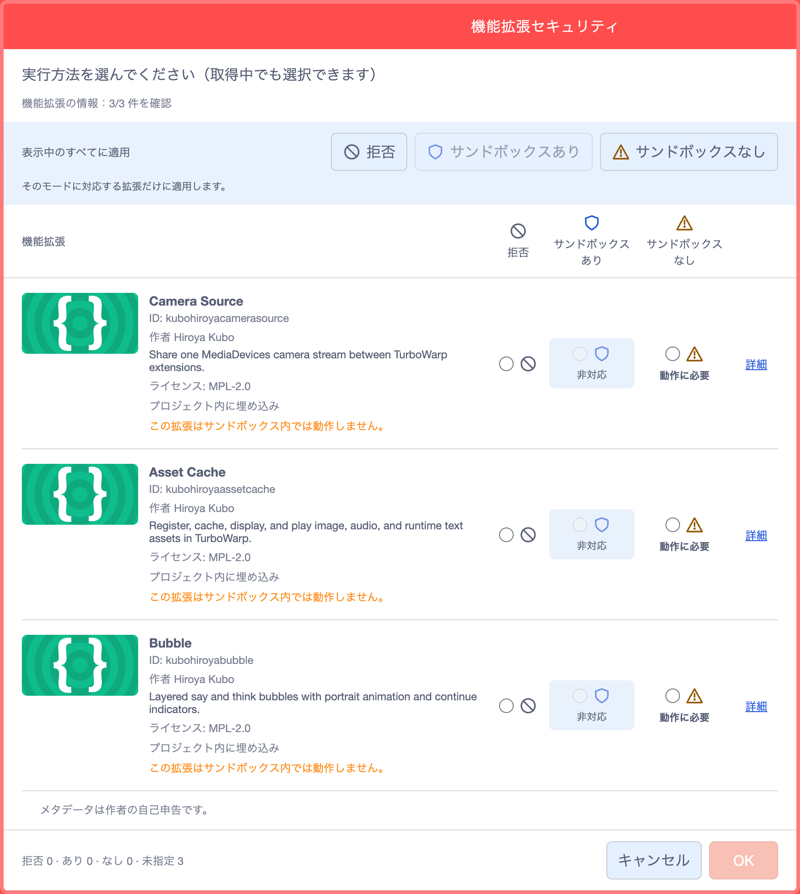
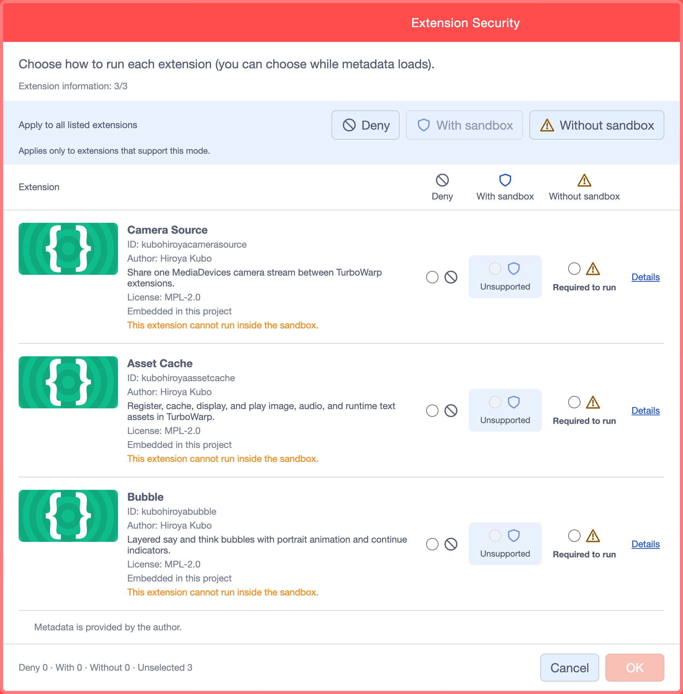
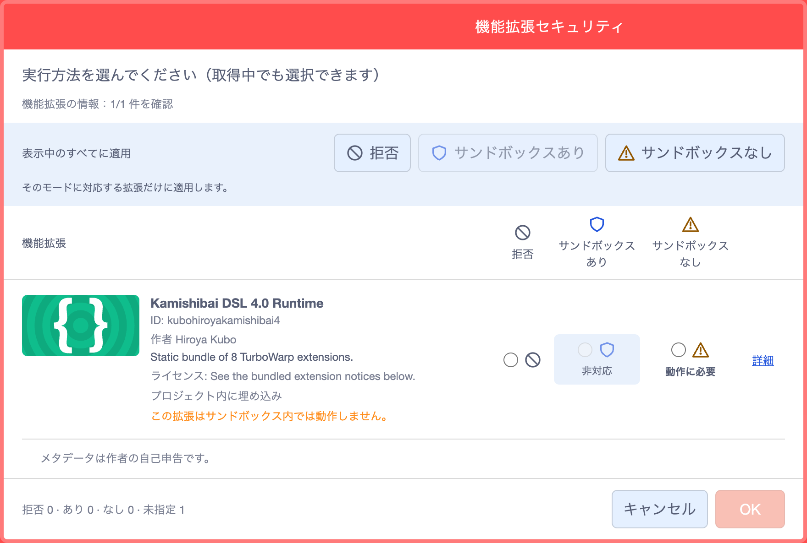
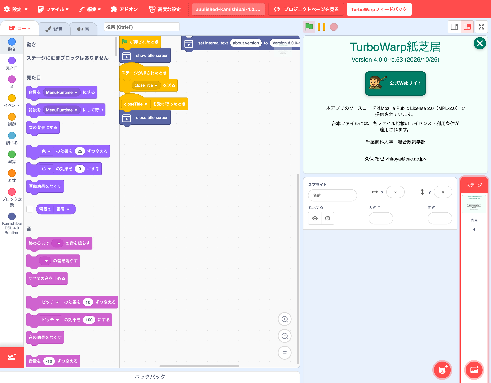
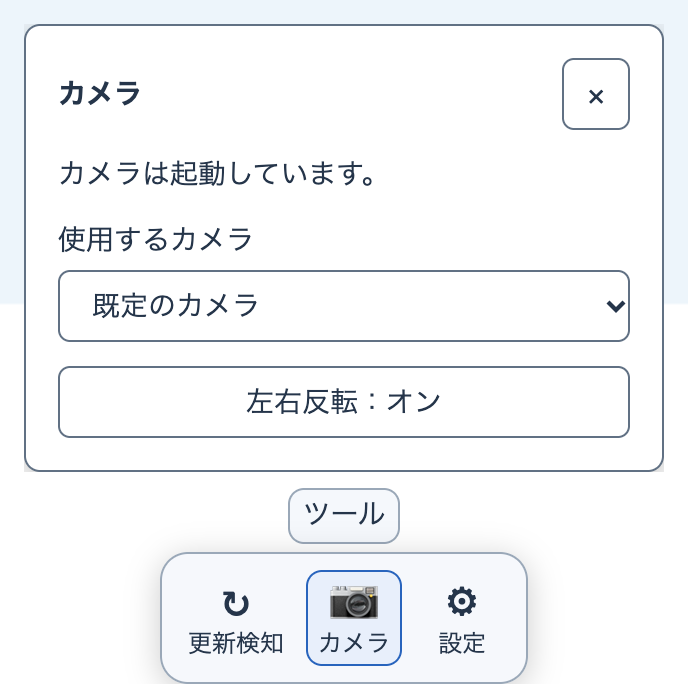

# 紙芝居アプリ 4.0 操作説明書

Copyright © 2026 Hiroya Kubo. この文書は[CC BY-SA 4.0](https://creativecommons.org/licenses/by-sa/4.0/)で提供します。

現在の公開App・Schema・サンプルの参照版は**4.0.0-rc.53**です。[対応Release](https://github.com/kubohiroya/turbowarp-kamishibai-app/releases/tag/v4.0.0-rc.53)のSB3を使います。CLIは[公開tagから準備する手順](../dsl-author-guides/dsl-4.0-block-script-conversion-guide.md#cli-from-release-source)で準備できます。同版のnpm公開状態は[4.0の入口](https://kubohiroya.github.io/turbowarp-kamishibai-docs/4.0/)で確認し、公開済みnpmを使う場合もSB3と版を揃えてください。以下の`4.0.0-rc.41`などの検証記録・図版は作成当時の版を示します。

この説明書は、TurboWarp紙芝居4.0のサンプル作品を初めてプレイする方と、進行を手伝う方のための案内です。
まずは「浦島太郎」を開き、作品を始める、進める、終えるという一連の操作を試します。

> **現在利用できるもの**
>
> ここで案内する4.0のサンプル作品はブラウザーで試せます。この説明は
> `4.0.0-rc.53`基準の公開サンプルを対象にしています。安定版`4.0.0`は未公開です。
> 画面がこの説明と異なる場合は、作品に表示された版と、画面内の案内を優先してください。

## まず遊んでみる

1. [浦島太郎 Web版](https://kubohiroya.github.io/turbowarp-kamishibai-samples/stories/urashima/web-4.0/)を開く
2. 読み込みが終わるまで待つ
3. タイトル画面に4.0と表示されていることを確かめ、右上の「×」を押す
4. 最初の場面が表示されたら、画面の案内に従って進める
5. 最後まで進んだら、音声とカメラが止まったことを確かめる

初回は読み込みに時間がかかることがあります。白い画面や`Loading`の表示が出ている間は、何度も押さずに待ってください。

## ブロック台本SB3を再生する

[浦島太郎](https://kubohiroya.github.io/turbowarp-kamishibai-samples/stories/urashima/)と
[チュートリアル](https://kubohiroya.github.io/turbowarp-kamishibai-samples/stories/tutorial/)の「ブロック台本SB3」は、台本と必要な素材を同梱しています。

1. 配布SB3を[公開Editor](https://kubohiroya.github.io/turbowarp-extension-data-editor/editor.html?lang=ja)で開き、[機能拡張セキュリティ](#extension-security)の情報を確認して、必要なモードを明示的に選び「OK」を押す
2. ステージ上の`kamishibai [4.0] []`の名前が空欄であることを確認する。これがルート台本になる
3. 緑の旗で起動し、タイトルの「閉じる」を押すと、つながっている台本ブロックの物語が始まる
4. セリフや待機時間を編集したら、もう一度緑の旗から開始し、タイトルを閉じて確認する

実行中の物語へ編集が自動反映されるわけではありません。素材を新しく加える場合は作者用のビルド手順が必要です。
詳しくは[ブロック版「紙芝居を作る」](../tutorials/create-blocks.md)を参照してください。

## パスワード付きの作品を開く

rc.51から、sealed形式の作品では「この紙芝居はパスワードで保護されています」と表示されます。配布元から別途受け取ったパスワードを入力して「開く」を押してください。誤入力時は再入力でき、「キャンセル」で中断できます。成功したパスワードはそのページを開いている間、同じ作品の再起動に使われます。ページを閉じた後はもう一度入力してください。

作者向けの通常の配布用SB3と、メニューの「YAMLなし」で作るcompiled形式には、このパスワード保護は付きません。sealedの作成手順は[開発者ガイド](../developer-guides/developer-guide-4.0.md#compiled-sealed-rc51)を参照してください。

## 機能拡張セキュリティ {#extension-security}

公開EditorでSB3を開くと、埋め込み拡張の実行方法をまとめて確認する画面が表示されます。
名前・ID・作者・説明・ライセンスを確認し、信頼できる配布元の拡張だけ実行してください。
「詳細」でソースコードも確認できます。メタデータは作者の自己申告です。

選択肢は左から次の順です。画面では絵文字に相当する線画アイコンで表示されます。

| アイコンと選択肢      | 操作の結果・意味                                                                                                                                                     |
| --------------------- | -------------------------------------------------------------------------------------------------------------------------------------------------------------------- |
| 🚫 拒否               | その拡張を実行しません。拡張が必要な作品は正常に動かないことがあります。                                                                                             |
| 🛡️ サンドボックスあり | Editorから分離された、アクセス権限に制限のある環境で実行します。盾は制限された実行環境を表し、安全性の認定ではありません。                                           |
| ⚠️ サンドボックスなし | 分離による制限を外して実行します。プロジェクトやブラウザーの情報にアクセスできるため、信頼できる拡張かを確認して選びます。警告は広いアクセス権限への注意を表します。 |

### 選べないモードと「動作に必要」

作者がサンドボックス外での実行を必須と宣言した拡張（`Unsandboxed: required`）では、
「サンドボックスあり」が灰色の「非対応」になり、選べません。
名前の下に「この拡張はサンドボックス内では動作しません。」と理由が表示されます。
「サンドボックスなし」には「動作に必要」と表示されます。

「動作に必要」は、その拡張を動かすために必要な実行モードを示します。
安全性や配布元の信頼性を保証する表示ではなく、自動で許可されることもありません。
必要な機能と配布元を確認したうえで、自分で選びます。

### Camera Source・Asset Cache・Bubbleで必要なモード

rc.53が同梱する次の3拡張は、いずれも「サンドボックスなし」を必要とします。単体で読み込む場合も同じです。

| 拡張と対応版         | サンドボックス外の実行が必要な理由                                                                                               |
| -------------------- | -------------------------------------------------------------------------------------------------------------------------------- |
| Camera Source 0.19.3 | ブラウザーのカメラを取得し、Editorの実行環境を通じて複数の拡張へ同じ映像を共有します。カメラ選択・左右反転の操作画面も扱います。 |
| Asset Cache 0.3.1    | 素材を保持するだけでなく、Editorの実行環境と描画機能へ直接アクセスして、画像・音声・実行時テキストを作品へ表示・再生します。     |
| Bubble 0.13.4        | Editorの実行環境と描画機能へ直接アクセスし、ステージ上へ重ねた吹き出しや立ち絵を描画・更新します。                               |

サンドボックス内では、これらに必要なEditor内部への直接アクセスが制限されるため動作しません。
「サンドボックスなし」はアクセス権限の広い実行方法です。必要な機能と配布元を確認し、自分で許可してください。
Camera Sourceの拡張実行を許可しても、ブラウザーのカメラ使用許可が自動で与えられることはありません。

**日本語の表示**では「非対応」「動作に必要」と、オレンジ色の「この拡張はサンドボックス内では動作しません。」を確認します。

<figure class="security-dialog-detail" tabindex="0">
  
  <figcaption>2026年10月25日の公開Editorで、公開npmの3拡張を同時に開いた実画面です。個別の選択と一括選択の両方で、非対応のモードは選べません。幅が狭い画面では画像を左右に動かせます。</figcaption>
</figure>

**英語の表示**では「Unsupported」「Required to run」と、「This extension cannot run inside the sandbox.」が同じ意味です。

<figure class="security-dialog-detail" tabindex="0">
  
  <figcaption>同じ公開Editorを英語で開いた実画面です。Required to runは実行要件を表し、信頼性の認定ではありません。</figcaption>
</figure>

rc.53のStandard SB3では、これらを含む拡張が「Kamishibai DSL 4.0 Runtime」の1つの同梱拡張として表示されます。
単体3拡張の画像と行数が違っていても、「サンドボックスなし」が必要な点は同じです。

<figure class="security-dialog-detail" tabindex="0">
  
  <figcaption>公開rc.53のStandard SB3を開いた画面です。配布元を確認し、「サンドボックスなし」を選んで「OK」を押します。</figcaption>
</figure>

<figure class="security-dialog-detail" tabindex="0">
  
  <figcaption>許可後に緑の旗を押したrc.53の起動画面です。タイトルの「閉じる」を押すと作品またはメニューへ進みます。</figcaption>
</figure>

拡張の読み込み後、緑の旗で作品を起動します。保存済みの選択がある場合も「OK」での確認が必要です。
情報の取得後に選択が非対応と分かった場合は、選択が解除されるので選び直します。
「表示中のすべてに適用」は、そのモードに対応する拡張だけが対象です。

実行したくない拡張は「拒否」を選べます。「OK」の後に出る確認では、作品が作者の意図どおり動かない可能性が案内されます。
作品全体の読み込みをやめる場合は「キャンセル」を押し、確認で「はい」を選びます。
「いいえ」なら選択を保持してこの画面へ戻ります。
機能拡張の許可と、ブラウザーによるカメラ使用の許可は別の操作です。

## 作品を進める

作品によって、キー、画面のタッチ、ポーズのいずれかを使います。まずは画面内の案内に従ってください。

進行役が先へ進めたいときは、次のキーを1回ずつ押します。

| キー         | 何が起きるか                     |
| ------------ | -------------------------------- |
| `Space`      | ポーズ待ちを終えて先へ進む       |
| `ArrowRight` | 読み上げや動きの途中から先へ進む |
| `ArrowDown`  | 今の場面を終えて次の場面へ進む   |

長押しすると複数の場面を飛ばすことがあります。画面が変わるまで、次のキーは押さないでください。

## カメラとポーズを使う

カメラは、ポーズで参加したい場合だけ使います。カメラを使わない場合や許可したくない場合は、キーや画面の
タッチで進められます。

カメラを使うときは、次の順に準備します。

1. 参加する人に、カメラを使うことを説明して同意を得る
2. 人や物にぶつからない場所を確保する
3. ブラウザーがカメラの使用を尋ねたら「許可」を選ぶ
4. 体が画面に収まる位置へ移動する
5. 画面の見本に合わせ、判定されるまで少し姿勢を保つ

うまく判定されないときは、部屋を明るくする、カメラから少し離れる、背景と服の色が重ならない場所へ
移動する、という順で試します。進行を優先する場合は`Space`を1回押してください。

カメラに第三者や個人情報が映り込まないようにします。プレイが終わったら、端末のカメラ使用中の表示が
消えたことも確認してください。

## カメラと制作ツールの共通入口

rc.41のEditorでは停止ボタンの後ろ、HTMLではDockの「カメラ」を押します。未起動なら許可・開始、起動中ならカメラ選択と左右反転の設定を開きます。別のカメラを選ぶときも、同じ入口を使います。

<figure class="runtime-settings-detail" tabindex="0">
  
  <figcaption>公開rc.41 HTMLのカメラ設定と入口の拡大です。「使用するカメラ」で機器を選び、「左右反転」で映像の向きを切り替えます。幅が狭い画面では、画像を左右に動かせます。</figcaption>
</figure>

撮影には操作確認用YAML台本とChromeの模擬カメラを使っています。

HTMLのDockは画面端の「ツール」から表示できます。「設定」で配置を上下左右に変更し、「自動的に隠す」を切り替えます。設定画面を開いている間はDockが隠れません。

「更新検知」は、外部のYAML台本を開いて制作しているときに使います。台本ファイルや関連素材の保存を検知して、プレビューへ反映します。普通に作品を遊ぶだけなら操作は不要です。詳しくは[台本DSLで「紙芝居を作る」](../tutorials/create.md#update-detection)を参照してください。

## 終える・もう一度見る

- 同じ作品を最初から見る: ページを再読み込みし、タイトル画面から始める
- 別の作品を見る: [作品一覧](https://kubohiroya.github.io/turbowarp-kamishibai-samples/)へ戻る
- 完全に終了する: タブを閉じ、カメラ使用中の表示が消えたことを確かめる

別のタブでも同じ作品を開いていると、カメラが動き続けることがあります。その場合は同じ作品を開いている
タブをすべて閉じてください。

## 困ったとき

| 状態                       | 戻り方                                                                   |
| -------------------------- | ------------------------------------------------------------------------ |
| タイトル画面が出ない       | 通信を確認し、ページを1回だけ再読み込みして待つ                          |
| `Loading`から進まない      | ページを再読み込みする。繰り返す場合は時間を置いて開き直す               |
| カメラを拒否した           | そのままキーや画面のタッチで進める                                       |
| 違うカメラが映る           | 共通の「カメラ」から、使うカメラを選び直す                               |
| ポーズが成立しない         | 明るさ、カメラとの距離、体の収まりを確認する。急ぐ場合は`Space`を押す    |
| 音が出ない                 | 端末の音量とミュートを確認し、タイトル画面から操作をやり直す             |
| エラーが表示された         | プレイを止め、表示された文章と直前の操作を作品の作者または進行役へ伝える |
| 終了後もカメラが動いている | 同じ作品を開いているタブを閉じる。消えなければブラウザーを終了する       |

エラーを伝えるためにカメラ画像を保存する必要はありません。画面の文章だけを記録してください。

## 自分の台本を試す

自分で台本を作っている方は、[私の浦島太郎 Web版](https://kubohiroya.github.io/turbowarp-kamishibai-samples/stories/my-urashima/web-4.0/)で
台本ファイルを選んで試せます。

ブロック台本で実習する方は、[私の浦島太郎のポーズ数選択](https://kubohiroya.github.io/turbowarp-kamishibai-samples/stories/my-urashima/#block-workshop)から
2・3・4ポーズのいずれかを選び、フォーム編集を始められます。操作は[ブロック版ガイド](../block-author-guides/dsl-4.0-block-author-guide.md#workshop-poses)を参照してください。

YAMLは、場面や登場人物を項目ごとに記述するテキスト形式です。4.0の台本ファイルは`.k4.yml`という名前で
保存します。画面の案内に従ってファイルを選び、エラーが表示されなければプレイを始めます。

台本が別の画像や音声を使っている場合は、それらのファイルも必要です。台本を最初から作る場合は、
[「紙芝居を作る」チュートリアル](../tutorials/create.md)から始めてください。

## 本番前の確認

- [ ] プレイする作品を最後まで試した
- [ ] 音量と画面の大きさを確認した
- [ ] キーまたは画面のタッチで進められることを確認した
- [ ] カメラを使う場合は、参加者の同意と安全な場所を確認した
- [ ] ポーズが成立しないときの進め方を確認した
- [ ] 終了後にカメラが止まることを確認した
